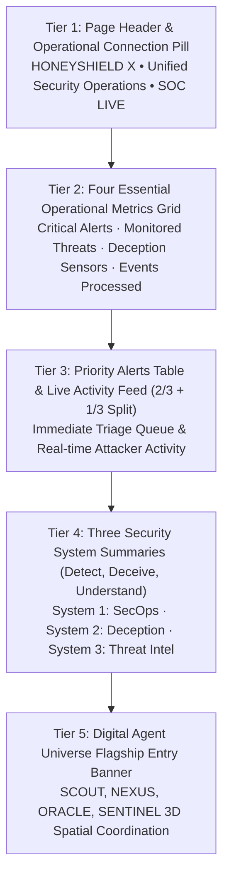

# HONEYSHIELD X — MILESTONE 20.2 ARCHITECTURE REPORT
## 03: BALANCED INFORMATION HIERARCHY & OPERATIONAL READING ORDER

**Document Version:** 1.0.0-rc5  
**Audit Date:** 2026-11-07  
**Subsystem:** Security Overview Layout Architecture  

---

### 1. The Six-Tier Operational Reading Order

Milestone 20.2 restructured `SecurityOverview.tsx` to follow a natural, incident-first reading order tailored for professional SOC analysts and security leads:

---

### 2. Layout Breakdown & Rationale

#### Tier 1: Page Header & Operational Connection Pill
- Provides instant confirmation of platform identity and infrastructure connectivity (`Infrastructure: 3/3 Services Online`).
- Features a quick-action shortcut to launch the Digital Universe directly.
- Houses the "Platform Guide" toggle to summon or dismiss the FTUX introduction.

#### Tier 2: Four Essential Operational Metrics
- High-level KPIs are consumable within 3 seconds.
- Clearly states:
  - How many critical alerts require triage.
  - Total monitored threat vectors and unique attacker IPs.
  - Truthful deception sensor health (`Canary Active (5 Unconfigured)`).
  - 24-hour persistent event ingestion total (or live stream fallback).

#### Tier 3: Priority Alerts & Recent Activity (Split View)
- Positioned immediately beneath the KPI cards to ensure that active, high-priority threats are visible above the fold on standard 1080p and 1440p displays.
- Allows one-click deep-link investigation directly into the forensics workspace.

#### Tier 4: Three Security System Summaries
- Structured overview of HoneyShield X's functional pillars:
  - **Detect**: Autonomous threat triage and SecOps workflows.
  - **Deceive**: Canary traps and honeypot decoy grid.
  - **Understand**: Threat intelligence, STIX 2.1 IOC fusion, and attribution.

#### Tier 5: Digital Agent Universe Flagship Entry Banner
- Positioned at the bottom of the overview as a dedicated gateway into the spatial cyber observatory without cluttering the primary operational triage workflow.

