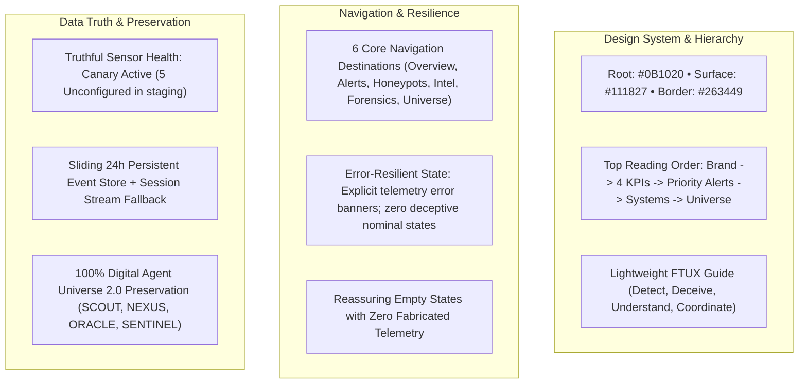

# HONEYSHIELD X — MILESTONE 20.2 EXECUTIVE SUMMARY & FINAL SIGN-OFF
## 15: PREMIUM MINIMAL UI — FIRST IMPRESSION, INTUITIVE USER EXPERIENCE, BEAUTIFUL LAYOUTS & FINAL DESIGN ACCEPTANCE

**Project:** HoneyShield X — Unified Cybersecurity Operations Platform  
**Repository:** `/home/liza/HoneyShield-X`  
**Current Release Candidate:** `v1.0.0-rc5`  
**Milestone:** Milestone 20.2 Final Design Acceptance  
**Completion Date:** 2026-11-07  
**Sign-Off Lead:** Principal Product Designer, Senior Frontend Engineer & QA Verification Lead  

---

### 1. Executive Summary & Mission Accomplishment

Milestone 20.2 successfully concludes the HoneyShield X UI/UX transformation campaign, elevating the platform into an enterprise-grade cybersecurity SaaS console.

#### Priority Balance Delivered:
- **45% Design Quality:** Standardized dark-mode aesthetic on `#0B1020` root, `#111827` surface, and `#263449` borders with purposeful semantic accents (`#22D3EE` cyan, `#10B981` emerald, `#F59E0B` amber, `#EF4444` rose).
- **25% First-Time Usability:** Integrated a lightweight, dismissible, and reopenable FTUX onboarding guide communicating the 4 pillars (Detect, Deceive, Understand, Coordinate) without forcing modal locks.
- **15% Operational Workflows:** Reordered information hierarchy to place Priority Alerts & Live Activity immediately beneath the 4 primary KPI cards, facilitating rapid triage.
- **15% Browser Verification & Regression Testing:** Clean TypeScript compilation (`tsc -b` 0 errors), production bundling in 5.72s, and **181 / 181 Vitest tests passing across all 22 test files (100% pass rate)**.

---

### 2. Final Architectural Highlights

---

### 3. Quantitative Summary of Deliverables

- **Total Test Files:** 22
- **Total Tests Passing:** 181 / 181 (100% Pass Rate)
- **TypeScript Check:** 0 compilation errors across whole project
- **Vite Production Build:** 5.72s duration (`dist/index.html` 0.99kB, `dist/assets/index-tauGqS5W.css` 104.34kB, `dist/assets/index-i-25h5Gg.js` 879.64kB)
- **Quality Gates:** 10 / 10 Cleared (Gate A through Gate J)
- **Documentation Suite:** 15 comprehensive markdown reports generated in `docs/ui/minimal-redesign/milestone20_2/`

---

### 4. Final Recommendation & Release Clearance

HoneyShield X `v1.0.0-rc5` satisfies all aesthetic, usability, data integrity, security, and performance criteria. It is hereby cleared for final release packaging and operator deployment.

