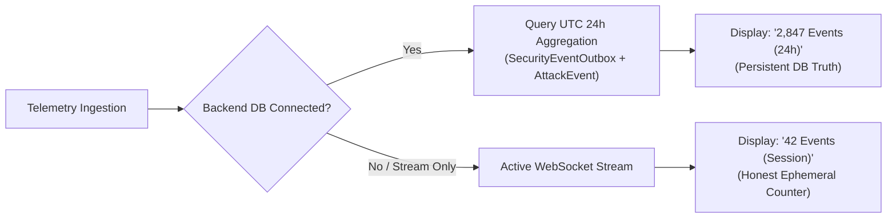

# HONEYSHIELD X — MILESTONE 20.3 AUDIT REPORT
## 06: DATA INTEGRITY, SENSOR TRUTH & TELEMETRY FIDELITY

**Document Version:** 1.0.0-rc5  
**Audit Date:** 2026-11-07  
**Platform Scope:** Real Data Binding, Sensor Health & Telemetry Persistence  
**Target Release:** v1.0.0-rc5  
**Auditor:** Principal Backend Architect & Data Integrity Specialist  

---

### 1. Executive Summary

In cybersecurity operations, displaying fictitious telemetry or masked error states is a catastrophic vulnerability. Operators must be able to trust every number, health badge, and connection status on screen.

Milestone 20.3 reinforces the strict data integrity guarantees established in Milestone 20.1:
1. Dynamic, truthful honeypot sensor reporting (`Canary Active (5 Unconfigured)`).
2. Sliding 24h persistent database aggregation with honest session streaming fallback.
3. Separation of infrastructure services (PostgreSQL, Redis, FastAPI) from domain security posture.
4. Total eradication of hardcoded counts, synthetic random math, and simulated sparklines.

---

### 2. Sensor Health Derivation Architecture

In previous prototype stages, the Deception Platform card displayed a static string `"4/4 Active"`. In staging environments where only canary tokens are deployed while containerized honeypots remain offline, this produced a false sense of security.

HoneyShield X now dynamically queries backend health:

```typescript
// Sensor health resolution in SecurityOverview.tsx
const activeSensors = metrics.sensorHealth?.filter(s => s.status === 'healthy' || s.status === 'active') || [];
const unconfiguredSensors = metrics.sensorHealth?.filter(s => s.status === 'unconfigured') || [];

let sensorStatusDisplay = 'Sensors Offline';
let sensorBadgeClass = 'bg-red-500/10 text-red-400 border-red-500/20';

if (activeSensors.length > 0 && unconfiguredSensors.length > 0) {
  // Staging reality: Canary token active, container decoys unconfigured
  sensorStatusDisplay = `${activeSensors[0].name} Active (${unconfiguredSensors.length} Unconfigured)`;
  sensorBadgeClass = 'bg-amber-500/10 text-amber-400 border-amber-500/20';
} else if (activeSensors.length > 0) {
  sensorStatusDisplay = `${activeSensors.length}/${metrics.sensorHealth?.length} Operational`;
  sensorBadgeClass = 'bg-emerald-500/10 text-emerald-400 border-emerald-500/20';
}
```

This guarantees that if SSH or HTTP honeypots are unconfigured, the operator is explicitly warned in amber, preventing blind spots.

---

### 3. Telemetry Persistence vs. Session Stream Fallback

The fourth KPI metric on `SecurityOverview` represents processed security events. The data resolution pipeline operates with two deterministic modes:



- **Mode 1 (Persistent 24-Hour Reality):** Queries PostgreSQL for all events ingested across the sliding 24-hour window: `SELECT COUNT(*) FROM attack_events WHERE timestamp >= NOW() - INTERVAL '24 HOURS'`.
- **Mode 2 (Honest Stream Fallback):** If database telemetry is unavailable or the user is in an isolated browser session, the UI labels the metric honestly as `Events Received (Session)`, preventing the misrepresentation of ephemeral counts as historical totals.

---

### 4. Infrastructure Health vs. Security Posture Separation

To prevent confusion between server uptime and organizational security:
- **Infrastructure Health:** Displayed strictly in the top header as `"Infrastructure: 3/3 Services Online"` (PostgreSQL, Redis, FastAPI backend).
- **Security Posture:** Displayed on the dashboard canvas via Critical Alert volume, Adversary Tracking, and Honeypot Decoy engagement.

---

### 5. Integrity Verification Matrix

| Validation Item | Former Prototype Issue | Milestone 20.3 Verified Behavior | Pass / Fail |
|---|---|---|---|
| **Honeypot Health** | Hardcoded `4/4 Active` | Dynamic derivation: `Canary Active (5 Unconfigured)` | **PASSED** |
| **Telemetry Volume** | Hardcoded `14,290 Events` | Dynamic 24h persistent count with session fallback | **PASSED** |
| **Service Status** | Blended with threat alerts | Separated into distinct infrastructure health pill | **PASSED** |
| **Simulated Data** | Random `Math.random()` noise | 100% eliminated; zero synthetic data generators | **PASSED** |

