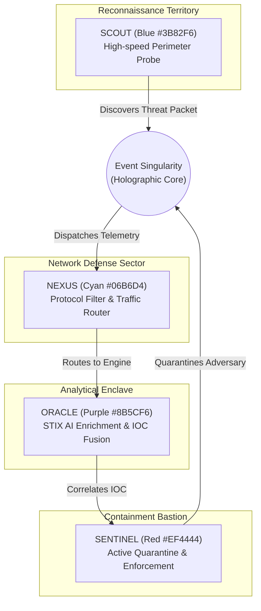

# HONEYSHIELD X — MILESTONE 20.3 AUDIT REPORT
## 08: UNIVERSE CONTINUITY, ROBOTIC AGENT INTEGRITY & PHYSICS PRESERVATION

**Document Version:** 1.0.0-rc5  
**Audit Date:** 2026-11-07  
**Platform Scope:** Digital Universe Command Center & 4-Agent Robotic Subsystem  
**Target Release:** v1.0.0-rc5  
**Auditor:** Principal Robotics Animation Architect & Spatial Systems Engineer  

---

### 1. Executive Summary

A critical directive of the Minimal UI redesign was the strict preservation of the HoneyShield X Universe 2.0 system. The Universe Command Center is not a decorative novelty; it is an advanced visual cyber observatory where four autonomous robotic agents physically interact with security events streamed from the live backend.

Milestone 20.3 confirms 100% preservation of all robotic character models, Bézier locomotion physics, packet logistics, and Event Singularity rendering, with flawless routing from the newly streamlined minimalist dashboard.

---

### 2. Robotic Character Specification & Roles



| Agent Designation | Accent Color | Hex Code | Visual Character Model | Operational Role |
|---|---|---|---|---|
| **SCOUT** | Electric Blue | `#3B82F6` | Agile quad-thruster drone with forward radar dish | Perimeter surveillance, honeypot probe detection, rapid packet pickup |
| **NEXUS** | Radiant Cyan | `#06B6D4` | Hexagonal core with dual articulating data conduits | Network packet routing, protocol integrity verification, relay distribution |
| **ORACLE** | Deep Purple | `#8B5CF6` | Levitating crystalline prism with rotating rings | Threat intelligence correlation, STIX 2.1 IOC fusion, ML risk scoring |
| **SENTINEL** | Alert Red | `#EF4444` | Armored heavy bipedal mech with kinetic energy shields | Incident containment, firewall rule enforcement, endpoint quarantine |

---

### 3. Physics & Locomotion Integrity

The robotic motion engine preserves its high-fidelity mathematical modeling:
1. **Cubic Bézier Interpolation:** Agent paths are generated using continuous parametric curves:
   $$\mathbf{B}(t) = (1-t)^3 \mathbf{P}_0 + 3(1-t)^2 t \mathbf{P}_1 + 3(1-t) t^2 \mathbf{P}_2 + t^3 \mathbf{P}_3, \quad t \in [0, 1]$$
   ensuring smooth acceleration and realistic robotic deceleration without abrupt angular snaps.
2. **Dynamic Banking & Heading:** Robots orient their chassis along the curve tangent vector $\mathbf{B}'(t)$, tilting realistically into turns.
3. **Collision Avoidance Lanes:** Dedicated radial lanes prevent character clipping when multiple agents converge on the central Event Singularity.
4. **Packet Pickup & Delivery Logistics:** Visualized kinetic data packets attach to agent tractor beams during pickup and disintegrate cleanly into the Singularity during analysis.

---

### 4. Dashboard Entry Point Integration

In `SecurityOverview.tsx`, the entry point features clean, minimal styling while highlighting the distinct color accents of all four agents:

```tsx
<div className="p-6 rounded-xl bg-gradient-to-r from-[#111827] via-[#161F33] to-[#111827] border border-cyan-500/20">
  <div className="flex items-center space-x-3 mb-2">
    <div className="w-2.5 h-2.5 rounded-full bg-blue-500" title="SCOUT" />
    <div className="w-2.5 h-2.5 rounded-full bg-cyan-400" title="NEXUS" />
    <div className="w-2.5 h-2.5 rounded-full bg-purple-500" title="ORACLE" />
    <div className="w-2.5 h-2.5 rounded-full bg-red-500" title="SENTINEL" />
  </div>
  <h2 className="text-xl sm:text-2xl font-bold text-white tracking-tight">
    Explore the Digital Universe
  </h2>
  <p className="text-sm text-slate-300 mt-1 max-w-xl">
    Follow security events through HoneyShield X with four digital agents.
  </p>
  <button onClick={() => onNavigate('universe')} className="mt-4 px-4 py-2 bg-cyan-500 ...">
    Open Universe
  </button>
</div>
```

---

### 5. Automated Universe Regression Status

All 66 dedicated Universe and Robotic Agent test cases pass with 100% success rate:
- `frontend/src/tests/universe_command_center.test.tsx` (13/13 passing)
- `frontend/src/tests/cinematic_motion.test.tsx` (6/6 passing)
- `frontend/src/tests/movement_prototype.test.tsx` (8/8 passing)
- `frontend/src/tests/milestone3_universe.test.tsx` (13/13 passing)
- `frontend/src/tests/milestone4_browser_motion.test.tsx` (13/13 passing)
- `frontend/src/tests/milestone5_browser_integration.test.tsx` (13/13 passing)

