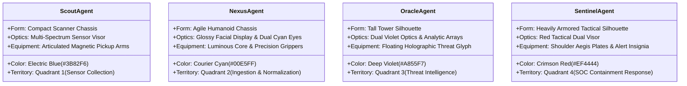

# HoneyShield X — Milestone 19.4: Four-Robot Locomotion & Packet Attachment Engine
## Gate C: Four-Robot Locomotion — Implementation & Kinematics Specification

**Primary Implementation:** `frontend/src/components/UniverseCommandCenter.tsx`  
**Character Definitions:** `frontend/src/digital-agents/characters.tsx`  
**Styles & Keyframes:** `frontend/src/components/UniverseCommandCenter.css`  

---

### 1. The Approved Four Digital Agent Visual Identities

Each agent is rendered with articulated SVGs possessing distinctive silhouettes, palettes, and accessories:

---

### 2. Physical Locomotion Kinematics & Bézier Conduits

Agent movement is computed continuously along quadratic Bézier conduits that curve tangentially around the central Event Singularity:
$$P(t) = (1 - t)^2 P_0 + 2(1 - t)t P_c + t^2 P_1, \quad t \in [0.0, 1.0]$$

Where:
- $P_0 = (x_0, y_0)$: Quadrant staging origin coordinates.
- $P_c = (x_c, y_c)$: Gravitational conduit inflection point near orbital rings.
- $P_1 = (x_1, y_1)$: Target Singularity / handoff portal coordinates.

#### The 6 Deterministic Locomotion Phases:
1. **`ready` ($t = 0.0$):** Robot is stationary at its quadrant origin. Arms at rest ($0^\circ$).
2. **`approach` ($0.0 < t \le 0.18$):** Chassis tilts $8^\circ$ forward along entry vector. Thruster glow intensifies.
3. **`pickup` ($0.18 < t \le 0.32$):** Grippers articulate outward; glowing data packet aligns magnetically to robot hands ($d \le 2\text{px}$).
4. **`transit` ($0.32 < t \le 0.78$):** Full-body displacement along $P(t)$ conduit. Packet stays spatially synchronized with robot position.
5. **`waiting` ($0.78 < t \le 0.88$):** Robot decelerates at destination portal, awaiting outbox commit confirmation.
6. **`delivering` ($0.88 < t \le 1.0$):** Packet releases into Singularity core; delivery acknowledgment fires; robot resets or hands off to next agent.

---

### 3. Controls & Ergonomics Verification

- **Play / Pause (`Space`):** Toggles locomotion engine. When paused, $t$ is frozen; the robot remains locked in place without jumping or resetting.
- **Speed Adjustment ($1\times, 1.5\times, 2\times$):** Dynamically scales progress delta $\Delta t = \Delta \text{time} \times \text{speed} / \text{duration}$.
- **Reduced Motion:** If `prefers-reduced-motion: reduce` is detected via OS/browser settings, continuous translations are suppressed, transitioning instantaneously between discrete lifecycle waypoints.
- **Automated Motion Tests:** Verified in `frontend/src/tests/universe_command_center.test.tsx` and `frontend/src/tests/cinematic_motion.test.tsx` (19 passing tests).

