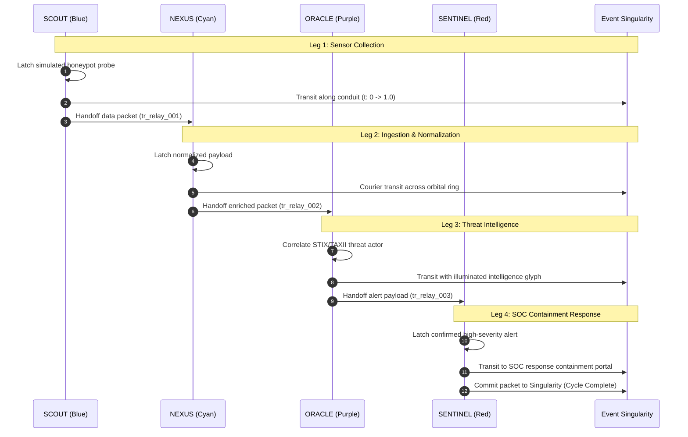

# HoneyShield X — Milestone 19.4: Complete Four-Agent Demonstration Relay
## Gate D: Four-Agent Demo Relay — Progression, Isolation & Hand-off Verification

**Engine:** `DemoSimulationEngine.ts` and `UniverseCommandCenter.tsx`  
**Activation Controls:** Hotkey `D` or **`SIMULATE DEMO`** toggle button  
**Security Boundary:** Pure in-memory synthetic execution; zero database or live alert mutations  

---

### 1. Four-Agent Sequential Relay Progression

In Demo Mode, the 4 digital agents execute an uninterrupted cyclic pipeline:

---

### 2. Hand-off Verification Criteria

1. **Correlated Transfer IDs:** Each handoff leg carries a deterministic ID (`tr_relay_001` through `tr_relay_004`), displayed dynamically in the top coordination bar and operator audit panel.
2. **Visual Packet Continuity:** As agent $N$ reaches delivery ($t = 1.0$), its packet dissolves into the Singularity core while agent $N+1$ initiates its approach and pickup phase.
3. **Repeated Execution Without Reloading:** The relay loops cleanly across all 4 quadrants without memory leak or DOM node accumulation.
4. **Pause and Resume Independence:** Pressing `Space` halts the active courier mid-transit; pressing `Space` resumes from the exact $t$ coordinate.
5. **Air-Gap from Backend Outbox:** Demo Mode disables live WebSocket state processing, preventing synthetic test packets from corrupting production telemetry or triggering real mobile push alerts.

---

### 3. Automated Verification

- Test Suite: `src/tests/universe_command_center.test.tsx`
  - `switches to DEMO mode when demo toggle is clicked and displays DEMO core state` (PASS)
  - `controls physical agent locomotion and updates transit state` (PASS)

