# HoneyShield X — Milestone 19.4: Live Backend Event Trace & Evidence
## Gate E: Real Live Event Integration — Multi-Profile Verification

**Execution Script:** `scripts/verify_milestone19_4_live_showcase.py`  
**Serialized Evidence:** `docs/ui/universe-v2/final-acceptance/evidence/milestone19_4_event_trace.json`  
**Standard:** 100% Telemetry Honesty — Monotonic Outbox Cursors & Non-Forced Pipeline Execution  

---

### 1. Verification Architecture

```mermaid
flowchart LR
    Sensor["Cowrie / Snort Sensor"] --> API["FastAPI Ingestion Endpoint"]
    API --> Tx["PostgreSQL Transaction (Commit)"]
    Tx --> Outbox["SecurityEventOutbox (Sequential Cursor)"]
    Outbox --> Redis["Redis Outbox Stream"]
    Redis --> WS["Authenticated WebSocket / SSE"]
    WS --> Adapter["React BackendEventAdapter"]
    Adapter --> Locomotion["Quadratic Bézier Locomotion"]
```

---

### 2. Multi-Profile Live Trace Execution Matrix

The trace was executed and verified via `scripts/verify_milestone19_4_live_showcase.py`:

| Profile | Step | Digital Agent | Action Performed | Resource ID | Outbox Cursor |
| :--- | :---: | :--- | :--- | :--- | :---: |
| **Profile A (Critical)** | 1 | `INGESTION_API` | Attack #1 DB Commit (Risk 98.2, Multi-Vector Brute-Force) | `attack:1` | *Pre-outbox* |
| | 2 | `SCOUT` | Sensor Telemetry Collection (120 probes/sec) | `attack:1` | **`#1`** |
| | 3 | `NEXUS` | Outbox ACID Persistence & Courier Relay | `attack:1` | **`#2`** |
| | 4 | `ORACLE` | STIX/TAXII Threat Intelligence Match (APT-41) | `attack:1` | **`#3`** |
| | 5 | `SENTINEL` | Alert Escalation & Mobile Containment Staging | `alert:1` | **`#4`** |
| **Profile B (Benign)** | 1 | `INGESTION_API` | Attack #2 DB Commit (Risk 14.5, Low-Severity ICMP Ping) | `attack:2` | *Pre-outbox* |
| | 2 | `SCOUT` | Sensor Telemetry Collection | `attack:2` | **`#5`** |
| | 3 | `NEXUS` | Audit Archival & Telemetry Normalization | `attack:2` | **`#6`** |
| | *Skip* | `ORACLE / SENTINEL` | **Legitimately Skipped:** Risk score 14.5 is below alert threshold (25.0) | *N/A* | *Skipped* |

---

### 3. Key Findings & Pipeline Integrity

1. **Strict Cursor Monotonicity:** Outbox cursors `[1, 2, 3, 4, 5, 6]` are strictly ascending and unique, guaranteeing total ordering across reconnects.
2. **Non-Forced Pipeline Execution:** In Profile B, low-risk telemetry is normalized and archived by SCOUT and NEXUS without fabricating fake ORACLE threat intelligence or false SENTINEL alerts.
3. **Database Commitment Prior to Notification:** Telemetry is committed to the persistent database before outbox envelopes are generated, preserving ACID transaction boundaries.

