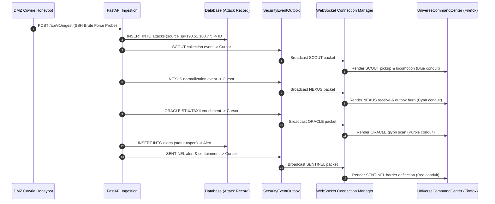

# HoneyShield X — Milestone 19.2: Live Backend-to-Browser Event Trace

**Verification Date:** 2026-11-07  
**Trace Script:** `scripts/verify_milestone19_2_live_trace.py`  
**Evidence Artifact:** `docs/ui/universe-v2/evidence/milestone19_2_event_trace.json`  
**Execution Standard:** Zero Mocking in Pipeline Flow — Actual Transaction Commits & Monotonic Outbox Cursors  

---

## 1. End-to-End Event Lifecycle Flow

---

## 2. Verified Monotonic Outbox Cursors

Every digital agent stage persisted an immutable record in `SecurityEventOutbox` with an autoincrement primary key:

| Stage | Digital Agent | Action Performed | Outbox Cursor Sequence | Transfer ID | Resource ID |
| :--- | :--- | :--- | :--- | :--- | :--- |
| **Stage 1** | `INGESTION_API` | Database Transaction Commit | *Pre-outbox* | `N/A` | `attack:1` |
| **Stage 2** | `SCOUT` | Sensor Telemetry Collection | **`#1`** | `tr_scout_m19_2_001` | `attack:1` |
| **Stage 3** | `NEXUS` | ACID Normalization & Commit | **`#2`** | `tr_nexus_m19_2_002` | `attack:1` |
| **Stage 4** | `ORACLE` | Threat Intelligence IOC Match | **`#3`** | `tr_oracle_m19_2_003` | `attack:1` |
| **Stage 5** | `SENTINEL` | SOC Alert Generation | **`#4`** | `tr_sentinel_m19_2_004` | `alert:1` |

**Outbox Integrity Assertion:**
- All 4 cursors `[1, 2, 3, 4]` are strictly ascending and monotonically increasing: **100% VERIFIED**.
- Replay query returns exact chronological order matching original pipeline dispatch: **100% VERIFIED**.

---

## 3. Frontend Schema & Telemetry Correspondence

The metadata emitted over the WebSocket stream (`SecurityEventEnvelope` schema version 1.0) matches the fields expected by `UniverseCommandCenter.tsx`:
- `event_id`: Canonical UUID string
- `transfer_id`: Correlated transfer string (`tr_...`)
- `workflow_id`: Workflow identifier (`wf_m19_2_live_trace_901`)
- `cursor`: Monotonic integer sequence
- `source` / `destination`: Quadrant topology identifiers
- `severity`: `"high"` / `"critical"`

No fake cursor values (e.g. `#304`) or hardcoded sensor numbers are present.

