# HoneyShield-X — Full-System Integration Audit Report

**Phase:** 3 — System Integration
**Mode:** READ-ONLY AUDIT / CONTROLLED VERIFICATION
**Git Baseline Commit:** `53f1d9c9dc02ccb81f5af6663e4db4189505d369`
**Evaluation Date:** 2026-10-29
**Audit Status:** **COMPLETE — Verified against committed repository and live runtime**

---

## 1. Git Baseline Verification

Repository state was audited from `/home/liza/HoneyShield-X`:

```bash
git status -sb
## main...origin/main

git log -5 --oneline
53f1d9c fix(frontend): resolve TypeScript compilation errors and harden component contracts
2c21c99 message
1641d4e test: isolate test fixtures and resolve cross-test db pollution
9fedd15 fix: normalize dual-scale replay risk semantics
068c056 feat: add retrospective threat hunting and adversary hypothesis engine

git rev-parse HEAD
53f1d9c9dc02ccb81f5af6663e4db4189505d369

git rev-parse origin/main
53f1d9c9dc02ccb81f5af6663e4db4189505d369
```

- **Branch:** `main`
- **Working Tree:** 100% clean, 0 untracked modifications in source tree
- **Synchronization:** Perfectly aligned with GitHub upstream `origin/main` (`0` ahead, `0` behind)
- **Baseline Integrity:** **CONFIRMED**

---

## 2. Platform Architecture & Subsystem Discovery

### 2.1 The Three-System Architectural Model vs. Reality

HoneyShield-X was conceptualized as three defensive tiers:
1. **System 1 (Detection & Pipeline Core):** Ingestion, normalization, multi-vector detection, correlation, threat intelligence enrichment, risk scoring, alerting, and notification dispatch.
2. **System 2 (Honeypot Sensor Grid):** External live honeypot listeners (Cowrie SSH, Dionaea malware traps, Conpot ICS sensors).
3. **System 3 (SOC Operations & Incident Management Console):** FastAPI backend, real-time event bus, incident command with Governor lockout safety, case management playbooks, deception canary tokens, threat hunting, campaigns clustering, and React frontend console.

#### The Real Runtime Decoupling
- **System 2 (Live Honeypots) is DISCONNECTED by design.** The production environment does not run external honeypot daemons over raw network sockets.
- **Architectural Independence:** System 1 and System 3 have **zero hard runtime or network dependencies on System 2**. System 1 functions strictly as an HTTP REST receiver (`POST /api/v1/ingestion/events` and `POST /api/v1/orchestrator/ingest-and-process`).
- **Demonstration / Live Ingestion Vehicle:** Controlled security event replay via `scripts/demo_replay.py` and the in-memory **Replay Studio (Module 3.3)** inject multi-stage attack scenarios deterministically into System 1.

---

### 2.2 Implemented System Architecture Diagram

```mermaid
flowchart TD
    subgraph External_Entities ["External & Attacker Layer"]
        Replay["Controlled Replay Runner<br/>(scripts/demo_replay.py)"]
        CanaryTrap["Attacker Tripwire<br/>(Canary Token HTTP Hits)"]
        Sys2["Live External Honeypots<br/>(Cowrie/Dionaea) [DISCONNECTED]"]
    end

    subgraph System_1 ["System 1: Pipeline & Detection Core"]
        IngestAPI["/api/v1/ingestion/events"]
        OrchAPI["/api/v1/orchestrator/ingest-and-process"]
        DetEngine["Detection Engine<br/>(Declarative Rules)"]
        MVDet["Multi-Vector Detection<br/>(Cross-Vector Thresholds)"]
        Correlation["Correlation Engine<br/>(Temporal & IP Clustering)"]
        TIEnrich["Threat Intel Enrichment<br/>(IOC Matching)"]
        RiskScore["Risk Scoring Engine<br/>(0..100 Multi-Factor)"]
        AlertManager["Alert Evaluation<br/>(Threshold >= 50.0)"]
        NotifDispatch["Notification Dispatcher<br/>(Deduplication & Webhooks)"]
    end

    subgraph Storage_Tier ["Dual-Mode Storage Tier"]
        subgraph Postgres ["PostgreSQL 17 (Relational ACID)"]
            TableAttacks[("attacks")]
            TableEvents[("attack_events")]
            TableAlerts[("alerts")]
            TableTI[("threat_intelligence")]
            TableSysEvents[("system_events (Audit/Compliance)")]
        end
        subgraph RedisStore ["Redis 7 + In-Memory Fallback"]
            Bus["EventBus: hsx:events:broadcast (Pub/Sub)"]
            Gov["Governor State & Lockout"]
            Cases["Incident Cases: hsx:case:*"]
            Canaries["Canary Tokens: hsx:deception:*"]
            Campaigns["Campaign Clusters: hsx:campaigns:*"]
            Hunts["Threat Hunts: hsx:hunting:*"]
            DLQ["Integrations & DLQ: hsx:integrations:*"]
            Sessions["Operator Sessions & Lockouts"]
        end
    end

    subgraph System_3 ["System 3: SOC Operations Console"]
        FastAPI["FastAPI REST Router (112 Endpoints)"]
        SSEStream["SSE Endpoint: /incident-command/stream"]
        AuthRBAC["RBAC & Governor Safety Gate"]

        subgraph Frontend_App ["React 19 + Vite Production Console"]
            ViewsDashboard["SOC Overview (Alerts & KPI Ribbon)"]
            ViewsCmd["Live Incident Command Center"]
            ViewsInvestigate["Attacker Entity Dossier & Graph"]
            ViewsReplay["Replay Studio & Rule Simulation"]
            ViewsCases["Case Management & Playbooks"]
            ViewsDeception["Active Deception & Canary Mint"]
            ViewsIntel["Threat Intelligence & IOC Fusion"]
            ViewsIntegrations["SIEM/SOAR Gateway & DLQ"]
            ViewsCampaigns["Attack Campaign Intelligence"]
            ViewsHunts["Retrospective Threat Hunting"]
            ViewsAudit["Operator Compliance Audit Trail"]
        end
    end

    Replay -->|POST REST Events| OrchAPI
    CanaryTrap -->|GET/POST Trap Hits| FastAPI
    IngestAPI --> DetEngine
    OrchAPI --> DetEngine
    DetEngine --> MVDet --> Correlation --> TIEnrich --> RiskScore --> AlertManager --> NotifDispatch

    DetEngine -.-> TableAttacks
    DetEngine -.-> TableEvents
    AlertManager -.-> TableAlerts
    TIEnrich -.-> TableTI
    NotifDispatch -.-> TableSysEvents

    AlertManager --> Bus
    Bus --> SSEStream
    SSEStream --> ViewsCmd

    FastAPI <--> Postgres
    FastAPI <--> RedisStore
    AuthRBAC --> FastAPI

    ViewsDashboard <--> FastAPI
    ViewsCmd <--> FastAPI
    ViewsInvestigate <--> FastAPI
    ViewsReplay <--> FastAPI
    ViewsCases <--> FastAPI
    ViewsDeception <--> FastAPI
    ViewsIntel <--> FastAPI
    ViewsIntegrations <--> FastAPI
    ViewsCampaigns <--> FastAPI
    ViewsHunts <--> FastAPI
    ViewsAudit <--> FastAPI
```



---

## 3. Infrastructure & Runtime Realities vs. Mocks/Simulations

| Component | Running Infrastructure Status | Storage Layer | Operational Reality |
| :--- | :--- | :--- | :--- |
| **FastAPI Backend** | **Running** (Uvicorn `0.0.0.0:8000`, PID 4855) | Memory / Network | Real API actively serving requests (200 OKs). |
| **Vite Frontend** | **Running** (`0.0.0.0:5173`, PID 4857) | Node / Browser | Real compiled SPA communicating with backend. |
| **PostgreSQL 17** | **Running** (`127.0.0.1:5432`) | Disk / Relational | 5 tables created via Alembic; contains 60+ attack records. |
| **Redis 7** | **Running** (`127.0.0.1:6379`) | Memory / Append-only | Active Pub/Sub, case caches, canary records, DLQ. |
| **System 2 (Honeypot)**| **Disconnected** | N/A | External honeypots replaced by Controlled Replay. |
| **Operator RBAC** | Real Enforced Backend Logic | In-Memory Registry | 4 real personas (`viewer`, `responder`, `hunter`, `admin`). |
| **Replay Studio** | Real Simulation Engine | In-Memory Sandbox | Bit-for-bit replay on historical events; zero side-effects. |
| **Threat Hunting** | Real Search & Hypothesis Engine | Redis + In-Memory | Executes real retroactive queries against PostgreSQL attacks. |
| **SOAR Dispatch** | Real Dispatcher + DLQ Circuit Breaker | Redis + In-Memory | Outbound webhooks to configured targets; SSRF validated. |

---

## 4. Full Feature Integration Matrix

| # | Subsystem / Feature Module | Backend Service Present? | API Route Present? | Frontend Connected to API? | Database / Storage Persistence? | Integration Status |
|---|:---|:---:|:---:|:---:|:---:|:---:|
| **1** | **Event Ingestion & Normalization** | ✅ `app/ingestion` | ✅ `POST /ingestion/events` | ⚠️ External/Replay | ✅ PostgreSQL (`attacks`, `attack_events`) | **Implemented (Headless/Pipeline)** |
| **2** | **Detection Rules Evaluation** | ✅ `app/detection` | ✅ `POST /detection/analyze/{id}` | ✅ `RuleCatalogView.tsx` | ✅ In-Memory Rule Registry | **Fully Integrated** |
| **3** | **Multi-Vector Correlation** | ✅ `app/multi_vector_detection` | ✅ `POST /detection/multi-vector/*`| ✅ `IpDossierView.tsx` | ✅ PostgreSQL (`attacks`, `attack_events`) | **Fully Integrated** |
| **4** | **Temporal Attack Correlation** | ✅ `app/correlation` | ✅ `POST /correlation/analyze/{id}`| ✅ `AttackChainGraph.tsx` | ✅ PostgreSQL (`attacks`, `attack_events`) | **Fully Integrated** |
| **5** | **Threat Intelligence Enrichment** | ✅ `app/threat_intelligence` | ✅ `POST /threat-intelligence/enrich`| ✅ `IpDossierView.tsx` | ✅ PostgreSQL (`threat_intelligence`) + Redis | **Fully Integrated** |
| **6** | **Composite Risk Scoring** | ✅ `app/risk` | ✅ `POST /risk/analyze/{id}` | ✅ `KpiRibbon.tsx` | ✅ PostgreSQL (`attacks.risk_score`) | **Fully Integrated** |
| **7** | **Alert Management & Lifecycle** | ✅ `app/alerts` | ✅ `GET/PATCH /alerts/*` | ✅ `AlertTable.tsx`, `AlertDetailDrawer` | ✅ PostgreSQL (`alerts`) | **Fully Integrated** |
| **8** | **Notification Webhook Dispatch** | ✅ `app/notifications` | ✅ `POST /notifications/alerts/{id}`| ⚠️ Internal Pipeline | ✅ PostgreSQL (`system_events`) | **Implemented (Pipeline)** |
| **9** | **Unified Pipeline Orchestrator** | ✅ `app/unified_orchestrator` | ✅ `POST /orchestrator/*` | ⚠️ Replay Runner | ✅ End-to-end Pipeline Persistence | **Fully Integrated (Replay)** |
| **10**| **SOC Overview & Telemetry KPIs** | ✅ `app/routers/dashboard.py` | ✅ `GET /dashboard/stats` | ✅ `KpiRibbon.tsx`, `Header.tsx` | ✅ PostgreSQL Aggregations | **Fully Integrated** |
| **11**| **Attacker Dossier & MITRE Graph** | ✅ `app/investigation` | ✅ `GET /investigation/*` (5 routes) | ✅ `IpDossierView.tsx`, `MitreMatrixView` | ✅ PostgreSQL Query Aggregation | **Fully Integrated** |
| **12**| **Historical Replay Studio** | ✅ `app/replay` | ✅ `POST /replay/attack/*`, `/ip/*` | ✅ `ReplayStudioView.tsx` | ✅ Read-only In-Memory Replay | **Fully Integrated** |
| **13**| **Candidate Rule Simulation** | ✅ `app/replay` | ✅ `POST /simulation/rule-test` | ✅ `SimulationSandboxView.tsx` | ✅ In-Memory Simulation | **Fully Integrated** |
| **14**| **Real-Time Event Stream (SSE)** | ✅ `app/incident_command/bus` | ✅ `GET /incident-command/stream` | ✅ `useIncidentStream.ts` | ✅ Redis Pub/Sub + In-Memory Queue | **Fully Integrated** |
| **15**| **Incident Command & Actions** | ✅ `app/incident_command` | ✅ `POST /incident-command/execute` | ✅ `LiveCommandCenterView.tsx` | ✅ Redis State + PostgreSQL `system_events` | **Fully Integrated** |
| **16**| **Governor Safety Lockout** | ✅ `app/incident_command/governor`| ✅ `GET/POST /governor/*` | ✅ `GovernorStatusRibbon.tsx` | ✅ Redis Cooldown + Flap Suppression | **Fully Integrated** |
| **17**| **Virtual Incidents Aggregation** | ✅ `app/incident_command` | ✅ `GET /incident-command/incidents`| ✅ `LiveCommandCenterView.tsx` | ✅ In-Memory / PostgreSQL Query | **Fully Integrated** |
| **18**| **Operator Authentication & RBAC** | ✅ `app/auth` | ✅ `POST /auth/login`, `GET /me` | ✅ `LoginModal.tsx`, `AuthContext.tsx` | ✅ Redis Sessions + In-Memory Registry | **Fully Integrated** |
| **19**| **Break-Glass Emergency Protocol** | ✅ `app/auth` | ✅ `POST /auth/break-glass` | ✅ `LoginModal.tsx` | ✅ Audit Logging (`system_events`) | **Fully Integrated** |
| **20**| **Compliance Audit Trail** | ✅ `app/audit` | ✅ `GET /audit/events` | ✅ `AuditTrailView.tsx` | ✅ PostgreSQL (`system_events`) | **Fully Integrated** |
| **21**| **Incident Case Management** | ✅ `app/cases` | ✅ `GET/POST/PATCH /cases/*` | ✅ `CaseManagementView.tsx`, `CaseDetail` | ✅ Redis (`hsx:case:*`) + `system_events` | **Fully Integrated** |
| **22**| **Automated Incident Playbooks** | ✅ `app/cases/playbooks.py` | ✅ `POST /cases/{id}/tasks/{t}/complete`| ✅ `CaseDetailDossier.tsx` | ✅ Redis Case State | **Fully Integrated** |
| **23**| **Post-Incident Reporting** | ✅ `app/cases/service.py` | ✅ `GET /cases/{id}/report` | ✅ `PostIncidentReportModal.tsx` | ✅ Redis Synthesis | **Fully Integrated** |
| **24**| **Active Deception & Honeytokens** | ✅ `app/deception` | ✅ `GET/POST/DELETE /deception/canaries`| ✅ `DeceptionGridView.tsx`, `CanaryMint` | ✅ Redis (`hsx:deception:*`) | **Fully Integrated** |
| **25**| **Canary Tripwire Validation** | ✅ `app/deception` | ✅ `GET/POST /deception/validate/{token}`| ⚠️ Attacker Trap URL | ✅ Redis Hit Tracking + Alert Trigger | **Fully Integrated (Trap)** |
| **26**| **Threat Intel Lifecycle & IOC CRUD**| ✅ `app/threat_intelligence` | ✅ `GET/POST/PUT /threat-intelligence/*`| ✅ `ThreatIntelView.tsx`, `IndicatorMint` | ✅ PostgreSQL (`threat_intelligence`) + Redis | **Fully Integrated** |
| **27**| **Feed Export (STIX / CSV / JSON)**| ✅ `app/threat_intelligence` | ✅ `GET /threat-intelligence/export/*` | ✅ `FeedExportModal.tsx` | ✅ PostgreSQL Streaming Serialization | **Fully Integrated** |
| **28**| **SIEM/SOAR Outbound Webhooks** | ✅ `app/integrations` | ✅ `GET/POST/PATCH/DELETE /endpoints/*` | ✅ `IntegrationsView.tsx`, `EndpointConfig` | ✅ Redis (`hsx:integrations:endpoints`) | **Fully Integrated** |
| **29**| **Dead-Letter Queue (DLQ) & Retry**| ✅ `app/integrations` | ✅ `GET/POST/DELETE /integrations/dlq/*` | ✅ `DlqDrawer.tsx` | ✅ Redis Bounded DLQ (max 500) | **Fully Integrated** |
| **30**| **Campaign Clustering & Graph** | ✅ `app/campaigns` | ✅ `GET/POST/PATCH /campaigns/*` | ✅ `CampaignsView.tsx`, `CampaignGraph` | ✅ Redis (`hsx:campaigns:*`) | **Fully Integrated** |
| **31**| **Campaign Containment Workflow** | ✅ `app/campaigns` | ✅ `POST /campaigns/{id}/contain` | ✅ `CampaignContainmentModal.tsx` | ✅ Redis State + Incident Command Bus | **Fully Integrated** |
| **32**| **Retrospective Threat Hunting** | ✅ `app/hunting` | ✅ `GET/POST/PATCH /hunts/*` (9 routes)| ✅ `ThreatHuntingView.tsx`, `HuntDossier`| ✅ Redis (`hsx:hunting:*`) | **Fully Integrated** |
| **33**| **Hunt Promotion to Case/Rule** | ✅ `app/hunting` | ✅ `POST /hunts/{id}/promote/*` | ✅ `HuntPromotionModal.tsx` | ✅ Redis + CaseStore + RuleRegistry | **Fully Integrated** |

---

## 5. Architectural Gap & Disconnection Analysis

1. **System 2 (Honeypot Sensor Infrastructure):**
   - **Gap:** Live honeypot listener daemons (Cowrie, Dionaea) are non-operational and not hosted in this environment.
   - **Mitigation / Architecture:** Replaced cleanly with REST event ingestion and controlled security-event replay via `scripts/demo_replay.py`. System 1 and System 3 are completely operational without System 2.
2. **PostgreSQL Relational Tables vs Redis State:**
   - **Observation:** The PostgreSQL database defines 5 core tables (`attacks`, `attack_events`, `alerts`, `threat_intelligence`, `system_events`).
   - **Zero-Migration Design:** Modules 3.4 through 3.11 intentionally utilize Redis primary storage (with thread-safe in-memory fallback) and write immutable audit records to `system_events` in PostgreSQL. This was an approved zero-migration architecture choice.
3. **Headless Pipeline Ingestion Endpoints:**
   - Endpoints such as `POST /api/v1/ingestion/events`, `POST /api/v1/orchestrator/ingest-and-process`, and `POST /api/v1/detection/analyze/{attack_id}` do not have direct user-facing form buttons in the SOC console. This is **correct and expected** because they are backend pipeline receivers for automated telemetry ingestion and replay scripts.
4. **Attacker Tripwire Endpoints:**
   - `GET/POST /api/v1/deception/validate/{token_id}` is intentionally not invoked by the SOC frontend. It serves as the trap URL embedded in canary documents, databases, or API keys for attacker tripping.

---

## 6. Audit Verdict

**OVERALL READINESS: PRODUCTION READY (SYSTEM 1 + SYSTEM 3)**
- Total Registered API Endpoints: **112**
- Frontend Views & Workspaces: **11 Comprehensive SOC Workspaces**
- Vitest Component Tests: **62/62 Passing across 11 Suites**
- TypeScript Compilation: **0 Errors (`strict: true`)**
- PostgreSQL & Redis Connectivity: **Connected & Verified**
- Architecture Integrity: **Verified Against Codebase**
