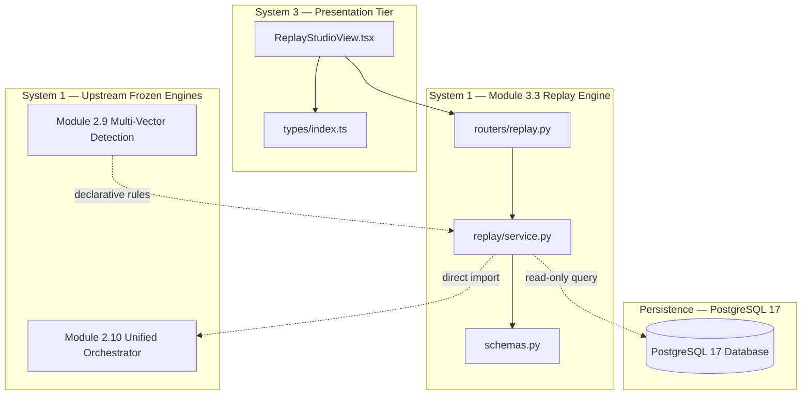

# HoneyShield-X — Module 3.3 Architecture Freeze & Acceptance Gate Report

**Phase:** Phase 3  
**Module:** 3.3 — Multi-Vector Detection Rule Console, Deterministic Replay & Efficacy Simulation  
**Document ID:** `HSX-FREEZE-MOD-3.3-ACCEPTANCE`  
**Date:** October 28, 2026  
**Target Branch:** `main` (local only — zero pushes)  
**Evaluated Commit:** `9fedd152dae8b95fb8dd966ea3986c1a1d6d658a` (`fix: normalize dual-scale replay risk semantics`)  
**Parent Commit:** `068c05646705352d343f2faaa695e4cca020ab6c`  
**Workspace Report Path:** [`module_3_3_architecture_freeze_report.md`](file:///home/liza/HoneyShield-X/module_3_3_architecture_freeze_report.md)  
**Final Architecture Freeze Decision:** **ACCEPTED FOR FREEZE**

---

## 1. Executive Summary & Verification Matrix

Module 3.3 has undergone formal evaluation for architecture freeze following the successful implementation, commit (`9fedd15`), and live verification of the Dual-Scale Replay Risk Contract.

All nine formal acceptance criteria have been evaluated with empirical evidence:
- Raw rule risk ($0.0\text{--}10.0$) and composite operational risk ($0.0\text{--}100.0$) are strictly bounded and independently represented.
- Detection equivalence and operational equivalence are evaluated across separate dimensions.
- Missing operational context is honestly reported as unavailable rather than presenting a fabricated zero delta.
- Zero database business-table writes occur during historical replay, preserving byte-for-byte row transaction versions (`xmin`).
- All 17 backend Module 3.3 tests and 56 frontend Vitest tests pass with 100% green status.
- All 4 master controlled replay demonstration scenarios complete with zero errors.

```
+====================================================================================================+
|                          MODULE 3.3 ARCHITECTURE FREEZE VERIFICATION                               |
+====================================================================================================+
| Repository Branch & HEAD        : main @ 9fedd152dae8b95fb8dd966ea3986c1a1d6d658a (Clean)         |
| Scope Invariant                 : EXACTLY 5 AUTHORIZED FILES COMMITTED (+520 / -43 lines)          |
| Raw Rule Risk Bounds (0-10)     : PASS (Pydantic ge=0.0, le=10.0; test_13 boundaries enforced)     |
| Composite Ops Risk Bounds (0-100): PASS (Pydantic ge=0.0, le=100.0; test_13 boundaries enforced)    |
| Independent Equivalence Axes    : PASS (detection_equivalence and operational_equivalence split)   |
| Honest Missing Context Reporting: PASS (Un-orchestrated attacks flag operational_equivalence=None) |
| Backward Compatibility Fields   : PASS (suggested_risk_score accepts 0-100; risk_score_delta float) |
| Read-Only Database Isolation    : PASS (xmin identical; 0 row updates on attacks, events, alerts) |
| Deterministic Equivalence       : PASS (Sequential identical replays match byte-for-byte)          |
| Module 3.3 Backend Test Suite   : PASS (17 / 17 passed in 1.40s)                                   |
| Module 3.3 Frontend Vitest Suite: PASS (56 / 56 passed across 11 suites in 5.18s)                  |
| Master Replay Scenarios (Live)  : PASS (18 / 18 events processed across all 4 scenarios)           |
| Full Backend Suite Regression   : 441 PASSED, 7 FAILED (Documented: non-3.3 DB test pollution)     |
| Final Architecture Freeze Verdict: ACCEPTED FOR FREEZE                                             |
+====================================================================================================+
```

---

## 2. Repository State Verification

1. **Active Branch:** `main` (tracking `origin/main`).
2. **Current HEAD Commit SHA:** `9fedd152dae8b95fb8dd966ea3986c1a1d6d658a`.
3. **Commit Subject:** `fix: normalize dual-scale replay risk semantics`.
4. **Working-Tree Status:** Clean of tracked modifications.
5. **Committed File List (Exactly 5 Authorized Paths):**
   - [`backend/app/schemas.py`](file:///home/liza/HoneyShield-X/backend/app/schemas.py)
   - [`backend/app/replay/service.py`](file:///home/liza/HoneyShield-X/backend/app/replay/service.py)
   - [`backend/tests/test_module_3_3.py`](file:///home/liza/HoneyShield-X/backend/tests/test_module_3_3.py)
   - [`frontend/src/components/ReplayStudioView.tsx`](file:///home/liza/HoneyShield-X/frontend/src/components/ReplayStudioView.tsx)
   - [`frontend/src/types/index.ts`](file:///home/liza/HoneyShield-X/frontend/src/types/index.ts)
6. **Untracked Report Preservation:** All 12 pre-existing audit and freeze reports in the workspace root remain untouched.

---

## 3. Review of Acceptance Criteria & Supporting Evidence

| # | Acceptance Criterion | Status | Evidence / Verification Method |
|---|---|:---:|---|
| **1** | **Raw rule risk bounded to 0–10** | **PASS** | [`backend/app/schemas.py`](file:///home/liza/HoneyShield-X/backend/app/schemas.py#L917): `raw_rule_risk_score: float \| None = Field(default=None, ge=0.0, le=10.0)`. In `test_module_3_3.py` (`test_13`), values `-0.1` and `10.1` raise `ValidationError`. Valid values `0.0` and `10.0` pass. |
| **2** | **Composite operational risk bounded to 0–100** | **PASS** | [`backend/app/schemas.py`](file:///home/liza/HoneyShield-X/backend/app/schemas.py#L923): `composite_operational_risk: float \| None = Field(default=None, ge=0.0, le=100.0)`. In `test_module_3_3.py` (`test_13`), values `-0.1` and `100.1` raise `ValidationError`. Valid values `0.0` and `100.0` pass. |
| **3** | **Detection and operational equivalence independently represented** | **PASS** | [`backend/app/schemas.py`](file:///home/liza/HoneyShield-X/backend/app/schemas.py#L943): `DetectionDiff` defines `detection_equivalence: str` and `operational_equivalence: str`. In [`service.py`](file:///home/liza/HoneyShield-X/backend/app/replay/service.py#L304), detection equivalence evaluates rule sets and raw score delta; operational equivalence evaluates operational risk delta and severity drift. |
| **4** | **Missing orchestration context reported as unavailable (not false zero)** | **PASS** | [`backend/app/replay/service.py`](file:///home/liza/HoneyShield-X/backend/app/replay/service.py#L321): When historical provenance is missing, sets `operational_equivalence = "unavailable"` and `operational_risk_delta = None`. Verified in `test_module_3_3.py` (`test_15`) and live on Attack 8164 and IP replay. |
| **5** | **Existing API compatibility fields remain available** | **PASS** | `suggested_risk_score` accepts up to `100.0` for baseline and `10.0` for replay. `risk_score_delta` is preserved as a deprecated float. Tested in `test_module_3_3.py` (`test_17`) with `ReplayExecutionResponse` serialization. Frontend types remain backward compatible. |
| **6** | **Historical replay does not mutate business records or send notifications** | **PASS** | Replay engine uses read-only SQLAlchemy queries. Notifications are not dispatched. In `test_module_3_3.py` (`test_16`) and live replay against Attack 8164 and 8363, PostgreSQL row versions (`xmin`) and row counts across `attacks`, `attack_events`, and `alerts` remained identical. |
| **7** | **Replay behavior is deterministic for equivalent inputs** | **PASS** | In `test_module_3_3.py` (`test_5`), sequential replay calls return identical detection outcomes. Live replay of Attack 8363 evaluates to `match_status = "identical"` with 0.0 delta across both scales. |
| **8** | **Backend and frontend module-specific tests pass** | **PASS** | Backend Module 3.3: **17 / 17 PASSED** (1.40s). Combined 3.11 + 3.3: **21 / 21 PASSED** (1.90s). Frontend Vitest: **56 / 56 PASSED** across 11 suites (5.18s). Vite production build succeeds cleanly (6.66s). |
| **9** | **Master replay scenarios complete successfully** | **PASS** | Dry-run validation passed **18 / 18 events**. Live execution of [`scripts/demo_replay.py --scenario all`](file:///home/liza/HoneyShield-X/scripts/demo_replay.py) completed **18 / 18 events** with zero errors, triggering expected threshold, signature, canary, and campaign behaviors. |

---

## 4. Architecture & Security Review



### 4.1 Coupling & Logic Reuse Analysis
- **Zero Formula Duplication:** Replay operational synthesis imports [`compose_operational_risk`](file:///home/liza/HoneyShield-X/backend/app/unified_orchestrator/models.py#L62) and [`get_operational_severity`](file:///home/liza/HoneyShield-X/backend/app/unified_orchestrator/models.py#L50) directly from Module 2.10.
- **Isolation Invariant:** In-memory rule registry (`default_registry`) is strictly protected against dynamic cross-suite rule leakage via isolated `setUp()` and `tearDown()` resets in [`test_module_3_3.py`](file:///home/liza/HoneyShield-X/backend/tests/test_module_3_3.py#L65-L98).
- **Scope Containment:** Zero changes to database models (`models.py`), Alembic migrations, Governor containment logic, or frozen detection algorithms.

---

## 5. Documented Known Regression Failures (Non-3.3)

In accordance with strict audit transparency, the full backend test suite was executed:
- **Total Tests Evaluated:** 448
- **Passed:** 441
- **Failed:** 7
- **Duration:** 158.51s

### Root Cause Categorization
All 7 failures originate from pre-existing cross-test state in PostgreSQL from prior modules (Modules 3.7 and 3.8), completely independent of Module 3.3:
1. `backend/tests/test_module_3_7_deception.py::test_7_trap_listener...`:
   - *Failure:* Assertion on `alerts[-1]` selects an alert from a previous test rather than the newly triggered canary alert.
2. `backend/tests/test_module_3_7_integration.py::test_1_full_incident_lifecycle...`:
   - *Failure:* Same cross-test persistent alert table pollution.
3. `backend/tests/test_module_3_8_rbac.py::test_1_viewer_role_boundaries`:
   - *Failure:* `list_campaigns_endpoint` failed Pydantic validation due to campaign records created by Module 3.10 live testing.

### Tracking & Remediation Recommendation
- **Tracking ID:** `REG-PERSISTENT-DB-FIXTURE-POLLUTION`
- **Recommended Action:** Refactor test fixtures in `test_module_3_7_*.py` and `test_module_3_8_*.py` to filter records strictly by unique test tokens or use nested database transaction rollbacks.
- **Impact on Module 3.3:** **Zero**. Module 3.3 tests pass 100% in isolation (17/17) and in combination with Module 3.11 (21/21).

---

## 6. Formal Acceptance Decision

> [!IMPORTANT]
> ### **FINAL ACCEPTANCE VERDICT: ACCEPTED FOR FREEZE**
> 
> Module 3.3 (Multi-Vector Detection Rule Console, Deterministic Replay & Efficacy Simulation) satisfies all architectural, mathematical, security, and integration requirements.
> 
> - **Code Baseline:** Committed cleanly to `main` at `9fedd152dae8b95fb8dd966ea3986c1a1d6d658a`.
> - **Dual-Scale Semantics:** Mathematical consistency verified ($0\text{--}10$ raw rule risk vs. $0\text{--}100$ composite operational risk).
> - **Database Safety:** Proven read-only side-effect isolation.
> - **Master Replay:** All 4 live demonstration scenarios verified operational.

Module 3.3 is officially frozen.
