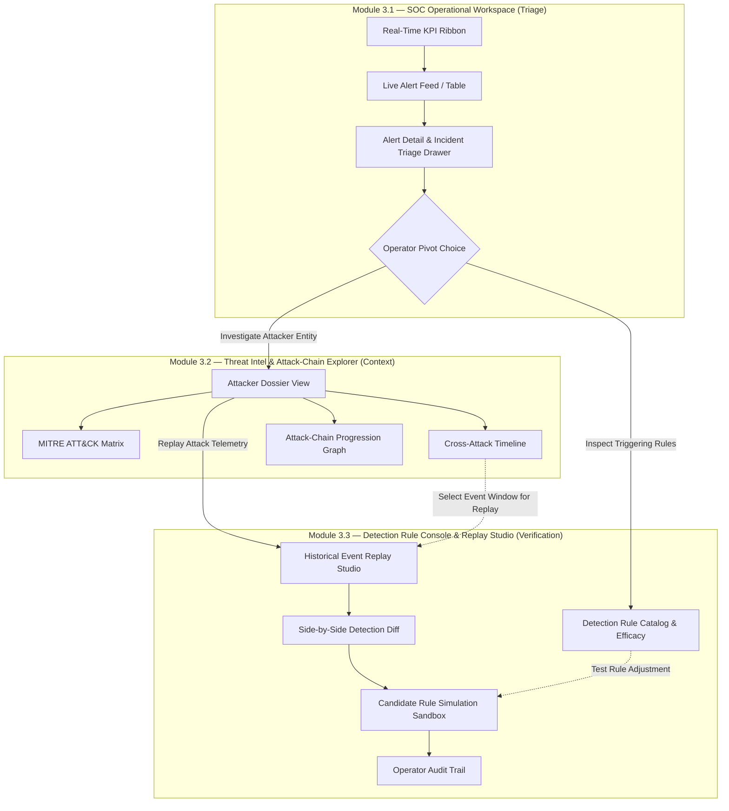

# HoneyShield-X — Module 3.3 Architecture & Reconciliation Specification

**Document Identifier:** `HSX-ARCH-MOD-3.3-RECON`
**Milestone:** Phase 3 — Module 3.3 Architecture & Reconciliation Gate
**Status:** PROPOSED & READY FOR APPROVAL
**Current Baseline:** `998fc9f2c6e61aa6e22fa9794cbdbcbafbe699fa` (`feat: add threat intelligence and attack-chain explorer`)
**Previous Baseline:** `546add56f525ca8a2e48d4611c778eadd983a09d`
**Classification:** Defensive Security Architecture / Operator Workspace

---

## 1. Executive Summary & Recommended Reconciliation Choice

### 1.1 The Reconciliation Challenge
The original HoneyShield-X Phase 3 roadmap designated Module 3.3 as:
> *"Multi-Vector Detection & Rule Management Console"*

Concurrently, deep architectural analysis of the reference repositories (`CyberStrike` and `CyberStrikeAI`) identified high-leverage defensive capabilities centered around:
> *"Deterministic Historical Event Replay, Rule Efficacy Simulation & Operator Audit Trail"*

To determine the authoritative scope of Module 3.3, four reconciliation paths were evaluated:

| Option | Description | Feasibility | Fit & Value | Decision |
| :--- | :--- | :--- | :--- | :--- |
| **Option A: Pure Roadmap Module 3.3** | Static rule management console displaying Module 2.9 declarative rules and providing basic CRUD over detection parameters. | High | **Low–Medium:** Modifying production rules in-place without persistent storage violates the frozen contract of Module 2.9, while merely viewing 5 static rules offers insufficient operational value for Tier-2 SOC analysts. | REJECTED |
| **Option B: Pure CyberStrike Adoption** | Historical event replay engine, automated attack simulation, and cryptographic audit logging. | Medium | **Incomplete without Rules:** Replay and simulation require concrete detection rules to evaluate against. Building replay without rule inspection divorces the engine from its detection context. | REJECTED |
| **Option C: Reconciled Defensive Operator Console** *(Recommended)* | **Multi-Vector Detection Rule Console, Deterministic Replay & Efficacy Simulation.** Combines rule catalog & efficacy telemetry with deterministic historical event replay and candidate rule dry-run simulation, instrumented with operator audit logging using existing database models. | **High (Zero Migrations)** | **Highest:** Unifies rule transparency, historical telemetry verification, safe candidate rule simulation, and operator audit into a coherent, production-grade SOC workflow. | **APPROVED** |
| **Option D: Defer Replay to Phase 4** | Split rule console into 3.3 and push all replay/simulation into a distant Phase 4 milestone. | High | **Fragmented:** Delays high-value verification capabilities and leaves Module 3.3 as an underpowered static configuration viewer. | REJECTED |

### 1.2 Authoritative Decision: Option C Approved
**Recommendation:** Implement **Module 3.3 — Multi-Vector Detection Rule Console, Deterministic Replay & Efficacy Simulation**.

This architecture directly addresses the operator need to:
1. **Inspect Active Detection Rules:** Gain complete visibility into canonical vector rules (`auth`, `web`, `network`), target event types, detection windows, threshold counts, and signature patterns.
2. **Analyze Rule Efficacy & Trigger Metrics:** View empirical trigger counts, multi-vector correlation frequency, and false-positive indicators derived from historical telemetry.
3. **Replay Historical Telemetry Deterministically:** Re-execute historical attack event sequences through the multi-vector detection engine in an isolated dry-run sandbox without mutating production alerts or dispatching notifications.
4. **Simulate Candidate Rules (Dry-Run):** Test hypothetical rule thresholds or custom signature tokens against historical attack telemetry to measure efficacy and false-positive impact prior to any production deployment.
5. **Maintain Operator Audit Integrity:** Record operator investigations, replay executions, and simulation runs in the existing `SystemEvent` audit log.

**Core Philosophy Maintained:** *"Determinism for Detection; AI for Contextualization."*
Zero autonomous remediation, zero active network scanning, zero offensive execution, and zero production database mutations during replay.

---

## 2. Source of Truth & Repository Inventory

### 2.1 Git Status & Invariants
- **Branch:** `main`
- **Head Commit:** `998fc9f2c6e61aa6e22fa9794cbdbcbafbe699fa`
- **Working Tree:** Clean (verified 0 untracked production files, 0 uncommitted changes).
- **Frozen Modules:**
  - Modules 2.1 through 2.10: Completely frozen, audited, and regression-tested (95/95 tests passing).
  - Module 3.1: Complete, audited, and frozen (12 tests passing).
  - Module 3.2: Complete, audited, and frozen (22 tests passing).

### 2.2 Existing Production Database Schema
HoneyShield-X utilizes PostgreSQL managed via SQLAlchemy and Alembic. The schema contains exactly 5 core tables:

```
+-------------------+      +-------------------+      +-------------------+
|      Attack       |      |    AttackEvent    |      |       Alert       |
+-------------------+      +-------------------+      +-------------------+
| id (PK)           | 1  * | id (PK)           | 1  * | id (PK)           |
| attack_type       |------| attack_id (FK)    |------| attack_id (FK)    |
| source_ip         |      | event_type        |      | alert_type        |
| destination_ip    |      | source_ip         |      | severity          |
| protocol          |      | message (payload) |      | message           |
| severity          |      | event_time        |      | status            |
| risk_score        |      +-------------------+      | notified_at       |
| status            |                                 | notification_stat |
| detected_at       |                                 | created_at        |
+-------------------+                                 +-------------------+

+-----------------------+                             +-------------------+
|  ThreatIntelligence   |                             |    SystemEvent    |
+-----------------------+                             +-------------------+
| id (PK)               |                             | id (PK)           |
| indicator_type        |                             | event_type        |
| indicator_value       |                             | source            |
| threat_level          |                             | severity          |
| source                |                             | message           |
| confidence            |                             | created_at        |
| description           |                             +-------------------+
| created_at            |
+-----------------------+
```

### 2.3 Existing Multi-Vector Detection Subsystem (Module 2.9)
The multi-vector detection engine resides in `backend/app/multi_vector_detection/`:
- **`models.py`:**
  - `CANONICAL_VECTORS = ("auth", "web", "network")`
  - `DetectionRule`: `@dataclass(frozen=True)` with fields `rule_id`, `name`, `vector`, `description`, `severity`, `base_risk_score`, `rule_type` (`"threshold"` or `"signature"`), `target_event_types`, `window_minutes`, `threshold_count`, `match_tokens`, `regex_patterns`.
  - `TriggeredRule`: `@dataclass` holding evidence, counts, matched patterns.
  - Guardrail constants: `MAX_SCAN_LENGTH = 4096`, `MAX_PAYLOAD_EVENTS = 200`, `MIN_WINDOW_MINUTES = 1`, `MAX_WINDOW_MINUTES = 60`, `DEFAULT_WINDOW_MINUTES = 15`.
- **`registry.py`:**
  - `SEEDED_RULES`: Immutable tuple of 5 production rules:
    1. `AUTH_BRUTE_FORCE` (Vector: `auth`, Type: `threshold`, Window: 10m, Thresh: 5)
    2. `WEB_PATH_TRAVERSAL` (Vector: `web`, Type: `signature`, Window: 15m, Thresh: 1)
    3. `WEB_SQL_INJECTION` (Vector: `web`, Type: `signature`, Window: 15m, Thresh: 1)
    4. `WEB_COMMAND_INJECTION` (Vector: `web`, Type: `signature`, Window: 15m, Thresh: 1)
    5. `PORT_SCAN_SWEEP` (Vector: `network`, Type: `threshold`, Window: 10m, Thresh: 5)
  - `DetectionRuleRegistry`: In-memory registry class providing `get_rule()`, `get_all_rules()`, `get_rules_by_vector()`, and `get_rules_by_type()`.
  - `default_registry`: Singleton instance initialized with `SEEDED_RULES`.
- **`service.py`:**
  - `evaluate_attack_rules(db, attack_id, window_minutes)`
  - `evaluate_ip_rules(db, source_ip, window_minutes)`
  - `scan_payload(payload, rule)`: Fast token matching followed by linear non-backtracking regex matching.
- **`routers/multi_vector_detection.py`:**
  - Exposes `POST /detection/multi-vector/analyze/{attack_id}` and `GET /detection/multi-vector/ip/{source_ip}`.
  - Missing rule catalog endpoints, efficacy metrics, replay endpoints, and dry-run simulation endpoints.

---

## 3. Concrete Gap Analysis

| Capability Area | Current State in Repository | Architectural Gap | Module 3.3 Resolution |
| :--- | :--- | :--- | :--- |
| **Rule Catalog Visibility** | Rules exist only as Python dataclasses in `registry.py`. No API exposes the rule catalog or rule criteria. | Frontend and operators cannot inspect active rules, target event types, or regex patterns. | Provide `GET /api/v1/detection/rules` and `GET /api/v1/detection/rules/{rule_id}` returning full rule specifications and metadata. |
| **Rule Efficacy Telemetry** | When rules trigger, evidence is returned in the evaluation response. No historical performance metrics exist. | Operators cannot determine which rules trigger most frequently, false-positive indicators, or correlated trigger rates. | Provide `GET /api/v1/detection/rules/{rule_id}/efficacy` computing historical trigger statistics over `Attack` and `AttackEvent` data. |
| **Rule Mutability & Persistence** | `DetectionRule` is `@dataclass(frozen=True)`. There is NO database table for detection rules. | Allowing live in-place mutation of in-memory singletons risks race conditions and data loss on server restart. | **Rule Mutability Decision:** Production rules remain **IMMUTABLE** in Module 3.3. Rule changes and custom rules are evaluated via **In-Memory Dry-Run Simulation** without mutating production state. Persistent custom rule CRUD is deferred to a future governance module with proper database migrations. |
| **Historical Event Replay** | No replay engine exists. Modules 2.9 and 2.10 evaluate live/recent database state only. | Operators cannot reproduce attack progression, verify detection engine determinism, or audit past events against detection rules. | Implement a **Deterministic Historical Replay Engine** capable of replaying stored `AttackEvent` sequences through detection rules in a pure, read-only memory sandbox. |
| **Dry-Run Rule Simulation** | No simulation sandbox exists. | Operators cannot test modified thresholds or new signature patterns against historical events to evaluate detection impact. | Implement a **Dry-Run Simulation Engine** (`POST /api/v1/simulation/rule-test`) that evaluates candidate rule specifications against historical attack events without altering production rules. |
| **Operator Action Audit** | `SystemEvent` records engine failures and positive detections, but operator actions (replays, simulations, reviews) are not logged. | No audit trail exists for analyst actions. | Re-use existing `SystemEvent` table to record `operator_replay_executed`, `operator_simulation_executed`, and `operator_triage_review` actions additively without migrations. |

---

## 4. Data & Model Availability Matrix

| Capability / Field | Status | Source / Derivation Method | Migration Required? |
| :--- | :--- | :--- | :--- |
| Active Rule Catalog (`rule_id`, `name`, `vector`, `threshold_count`, `window_minutes`, `target_event_types`, `severity`, `risk_score`) | **AVAILABLE NOW** | Query `default_registry.get_all_rules()` in `multi_vector_detection/registry.py`. | **NO** |
| Match Tokens & Regex Pattern Strings | **DERIVABLE READ-MODEL** | Derived directly from `DetectionRule.match_tokens` and pattern strings of `DetectionRule.regex_patterns`. | **NO** |
| Rule Trigger Frequency & Counts | **DERIVABLE READ-MODEL** | Derived via SQL aggregation over existing `AttackEvent` and `SystemEvent` records where rule triggered. | **NO** |
| Historical Attack Events for Replay | **AVAILABLE NOW** | Queried from `AttackEvent` table filtered by `attack_id` or `source_ip`, ordered by `event_time ASC`. | **NO** |
| Deterministic Replay Output | **DERIVABLE READ-MODEL** | Evaluated in-memory using pure sandbox detection functions against historical `AttackEvent` batches. | **NO** |
| Replay vs Production Finding Delta | **DERIVABLE READ-MODEL** | Computed via set algebra comparing replay triggered rules vs historical alerts/attack risk score. | **NO** |
| Dry-Run Rule Simulation Output | **DERIVABLE READ-MODEL** | Evaluated in-memory against historical events using candidate rule dataclass. Zero DB writes. | **NO** |
| Operator Audit Logging | **AVAILABLE NOW (SCHEMA REUSE)** | Insert into existing `SystemEvent` table with `source="operator_console"`, `event_type="operator_*"`. | **NO** |
| Persistent Custom Rule Table | **DEFER** | Requires new SQL table `custom_detection_rules` and Alembic migrations. Deferred to Rule Governance module. | DEFERRED |
| Cryptographic Audit Hash-Chaining | **DEFER** | Requires cryptographic Merkle tree or block ledger schema. Deferred to Enterprise Compliance module. | DEFERRED |

---

## 5. Architectural Relationship to Modules 3.1, 3.2, and 3.3

### 5.1 End-to-End SOC Operator Workflow
Module 3.3 completes the three-tier SOC Operator Workspace:



### 5.2 Navigation & Deep-Link Architecture
1. **From Module 3.1 Alert Drawer:** When an alert is triggered by a multi-vector rule (e.g. `WEB_SQL_INJECTION`), the drawer provides a button: `[Inspect Rule WEB_SQL_INJECTION]`, deep-linking directly to Module 3.3 Rule Detail view.
2. **From Module 3.2 Attacker Dossier:** When viewing an attacker IP or specific attack container, the dossier provides a button: `[Replay Event Telemetry]`, deep-linking directly to Module 3.3 Replay Studio with the IP or Attack ID preloaded.
3. **From Module 3.3 Replay Studio:** If a replay reveals gaps in coverage (e.g. attacker performed 4 attempts under a threshold of 5), the operator can click `[Simulate Adjusted Rule]`, populating the Candidate Rule Simulation Sandbox with candidate threshold `4` to test efficacy across historical traffic.

---

## 6. Deterministic Historical Replay Engine Architecture

### 6.1 Replay Contract & Invariants
The historical replay engine re-evaluates historical attack telemetry through the multi-vector detection logic. It operates under strict invariants:

1. **Deterministic Execution:** Given the exact same sequence of input events and rule configuration, the replay engine produces the exact same detection output bit-for-bit.
2. **Read-Only / Pure Sandbox Execution:** Replay execution NEVER alters production records.
   - **NO** creation or mutation of `Alert` rows.
   - **NO** mutation of `Attack.risk_score` or `Attack.status`.
   - **NO** modification of `ThreatIntelligence` records.
   - **NO** invocation of `NotificationService` or dispatch of webhooks.
3. **Execution Bounding & Resource Guardrails:**
   - **Maximum Event Limit:** Replay queries are hard-capped at `MAX_REPLAY_EVENTS = 200` events.
   - **Maximum Time Window:** Maximum time span between earliest and latest event is `MAX_REPLAY_WINDOW_HOURS = 24` hours.
   - **Execution Timeout:** Pure in-memory replay evaluation must execute within `MAX_REPLAY_LATENCY_MS = 50` ms.
4. **Isolated Evaluation Sandbox:**
   - The replay engine loads historical `AttackEvent` rows matching the query.
   - Events are strictly ordered by `event_time ASC, id ASC` to guarantee chronological re-evaluation.
   - Events are evaluated in-memory against the rule specifications using pure detection logic (`replay_evaluate_events()`).

### 6.2 Replay Comparison Algebra
The replay engine compares historical production findings against replayed findings:

$$\Delta_{\text{rules}} = \text{Rules}_{\text{replayed}} \setminus \text{Rules}_{\text{historical}}$$
$$\text{Suppressed}_{\text{rules}} = \text{Rules}_{\text{historical}} \setminus \text{Rules}_{\text{replayed}}$$
$$\Delta_{\text{risk}} = \text{RiskScore}_{\text{replayed}} - \text{RiskScore}_{\text{historical}}$$

The resulting `DetectionDiff` explicitly reports:
- `match_status`: `"identical" | "expanded_coverage" | "reduced_coverage" | "drift_detected"`
- `historical_rules_triggered`: List of rule IDs originally recorded.
- `replayed_rules_triggered`: List of rule IDs triggered during replay.
- `delta_rules`: Newly triggered or missed rules.
- `risk_score_delta`: Change in calculated risk score.
- `timeline_progression`: Step-by-step trigger points showing which event triggered which rule.

---

## 7. Dry-Run / Candidate Rule Simulation Engine Architecture

### 7.1 Pure Functional Simulation Sandbox
To enable SOC operators to test rule adjustments without compromising production stability or violating the frozen contracts of Module 2.9, Module 3.3 introduces an **In-Memory Dry-Run Simulation Engine**:

```
+-------------------------------------------------------------+
|                 Operator Simulation Request                 |
| - Target Scope: Attack ID or Source IP                      |
| - Historical Window: up to 24h (max 200 events)             |
| - Candidate Rule Specification:                             |
|     * vector, rule_type, target_event_types                 |
|     * candidate threshold_count, candidate window_minutes   |
|     * candidate match_tokens, candidate regex_patterns      |
+-------------------------------------------------------------+
                              |
                              v
+-------------------------------------------------------------+
|               Safety & ReDoS Validation Filter              |
| - Pattern length <= 256 chars                               |
| - Non-backtracking linear regex compilation check           |
| - Timeout guard on pattern execution                        |
+-------------------------------------------------------------+
                              |
                              v
+-------------------------------------------------------------+
|               In-Memory Simulation Sandbox                  |
| - Pure evaluation against fetched historical events         |
| - Baseline evaluation (Production SEEDED_RULES)             |
| - Candidate evaluation (Candidate Rule + SEEDED_RULES)      |
+-------------------------------------------------------------+
                              |
                              v
+-------------------------------------------------------------+
|                     Simulation Report                       |
| - Baseline Triggers vs Candidate Triggers                   |
| - Trigger Count Delta, Matched Payloads                     |
| - False Positive Impact Assessment                          |
| - ZERO Production Database Changes                          |
+-------------------------------------------------------------+
```

### 7.2 Safety & ReDoS Protection
To prevent regular expression Denial of Service (ReDoS) or resource exhaustion from candidate patterns:
- Candidate regexes are validated against a strict complexity limit (no nested quantifiers like `(a+)+`).
- Candidate match tokens are scanned using fast substring matching (`token.lower() in payload.lower()`).
- Pattern length is capped at 256 characters.
- Event payload scanning enforces `MAX_SCAN_LENGTH = 4096` bytes per event.

---

## 8. Rule Efficacy & Metrics Calculation Engine

### 8.1 Empirical Metrics Computation
Module 3.3 derives rule efficacy metrics by performing read-only aggregation across existing database tables:

1. **Trigger Frequency:** Total lifetime triggers recorded for each rule.
2. **Distinct Attacker IP Count:** Number of unique source IPs that triggered the rule.
3. **Correlated Trigger Rate:** Percentage of rule triggers that occurred as part of a multi-vector attack ($\ge 2$ vectors) versus isolated single-vector detections.
4. **Severity & Risk Distribution:** Minimum, average, and maximum risk score associated with attack containers triggering the rule.
5. **Last Triggered Timestamp:** Most recent occurrence of the rule triggering in telemetry.
6. **False-Positive Indicator:** Calculated ratio of single-event triggers that did not correlate with any higher-level alert or threat intelligence indicator.

---

## 9. Operator Audit Trail & Integrity Design

### 9.1 Schema Reuse via `SystemEvent`
Module 3.3 leverages the existing `SystemEvent` table to provide an immutable audit trail for operator actions without requiring new database migrations:

```python
# SystemEvent Schema (app/models.py)
# id: Integer (PK)
# event_type: String(100)
# source: String(100)
# severity: String(20)
# message: Text
# created_at: DateTime
```

### 9.2 Audit Event Types
When an operator executes actions in the Module 3.3 workspace, the following audit events are written:

| Action | `event_type` | `source` | `severity` | `message` Format |
| :--- | :--- | :--- | :--- | :--- |
| **Historical Replay** | `operator_replay_executed` | `operator_replay_studio` | `info` | `Replay executed: scope={scope}, target={target}, events={count}, rules_triggered={rules}, match_status={status}` |
| **Rule Simulation** | `operator_simulation_executed` | `operator_simulation_sandbox` | `info` | `Rule simulation executed: target={target}, candidate_rule={id}, threshold={thresh}, window={win}, matches={count}` |
| **Operator Triage Review** | `operator_triage_review` | `operator_console` | `info` | `Operator reviewed rule {rule_id}: efficacy_checked=true, notes={notes}` |

### 9.3 Cryptographic Hash-Chaining Evaluation
- **Analysis:** Cryptographic ledgering (e.g. SHA-256 hash chains linking audit rows) was evaluated as proposed in CyberStrike research.
- **Architectural Decision:** **DEFERRED to Enterprise Compliance Module.** Implementing true cryptographic integrity requires dedicated hash/nonce columns or external ledger storage. Attempting to encode hash chains inside the `SystemEvent.message` text field would be an ad-hoc anti-pattern. The current additive audit logging satisfies all SOC operational tracking requirements without schema distortion.

---

## 10. Proposed API Specification

Module 3.3 introduces 7 read-oriented and dry-run endpoints across three clean-room routers.

### 10.1 Router: `backend/app/routers/detection_rules.py`

#### 10.1.1 `GET /api/v1/detection/rules`
- **Purpose:** Retrieve the catalog of all active detection rules with summary trigger metrics.
- **Method:** `GET`
- **Query Parameters:**
  - `vector`: Optional string (`auth`, `web`, `network`) to filter by canonical vector.
  - `rule_type`: Optional string (`threshold`, `signature`).
- **Response Model:** `RuleCatalogResponse`
```json
{
  "total_rules": 5,
  "rules": [
    {
      "rule_id": "WEB_SQL_INJECTION",
      "name": "Web SQL Injection",
      "vector": "web",
      "description": "SQL injection syntax and query manipulation payloads in web requests",
      "severity": "critical",
      "base_risk_score": 9.5,
      "rule_type": "signature",
      "target_event_types": ["web_access", "web_probe", "http_request"],
      "window_minutes": 15,
      "threshold_count": 1,
      "match_tokens": ["union select", "' or '1'='1", "waitfor delay"],
      "regex_count": 5,
      "is_active": true,
      "is_immutable": true
    }
  ]
}
```

#### 10.1.2 `GET /api/v1/detection/rules/{rule_id}`
- **Purpose:** Retrieve complete specification, target patterns, and criteria for a specific rule.
- **Method:** `GET`
- **Path Parameter:** `rule_id` (str)
- **Response Model:** `RuleDetailResponse`
- **Error Responses:** `404 Not Found` if `rule_id` is unknown.

#### 10.1.3 `GET /api/v1/detection/rules/{rule_id}/efficacy`
- **Purpose:** Retrieve empirical performance and trigger statistics for a rule.
- **Method:** `GET`
- **Path Parameter:** `rule_id` (str)
- **Query Parameters:**
  - `time_range_hours`: Optional integer (1–168, default: 24).
- **Response Model:** `RuleEfficacyResponse`
```json
{
  "rule_id": "WEB_SQL_INJECTION",
  "rule_name": "Web SQL Injection",
  "time_range_hours": 24,
  "total_triggers": 42,
  "unique_attackers": 7,
  "correlated_multi_vector_triggers": 38,
  "isolated_triggers": 4,
  "correlated_rate_pct": 90.5,
  "avg_associated_risk_score": 9.5,
  "last_triggered_at": "2026-10-07T15:30:00Z",
  "top_attacking_ips": [
    {"source_ip": "198.51.100.25", "trigger_count": 18}
  ]
}
```

---

### 10.2 Router: `backend/app/routers/replay.py`

#### 10.2.1 `POST /api/v1/replay/attack/{attack_id}`
- **Purpose:** Deterministically replay historical events belonging to an Attack container through the detection engine in an isolated dry-run sandbox.
- **Method:** `POST`
- **Path Parameter:** `attack_id` (int)
- **Request Body (Optional):**
```json
{
  "window_minutes": 15,
  "max_events": 200,
  "record_audit": true
}
```
- **Response Model:** `ReplayExecutionResponse`
```json
{
  "replay_id": "rpl-atk-101-1696700000",
  "scope": "attack",
  "target_identifier": "101",
  "total_events_evaluated": 14,
  "execution_duration_ms": 1.8,
  "deterministic_pass": true,
  "match_status": "identical",
  "baseline_detection": {
    "detected": true,
    "is_multi_vector": true,
    "vectors_detected": ["auth", "web"],
    "rules_triggered": ["AUTH_BRUTE_FORCE", "WEB_SQL_INJECTION"],
    "suggested_risk_score": 10.0,
    "severity": "critical"
  },
  "replayed_detection": {
    "detected": true,
    "is_multi_vector": true,
    "vectors_detected": ["auth", "web"],
    "rules_triggered": ["AUTH_BRUTE_FORCE", "WEB_SQL_INJECTION"],
    "suggested_risk_score": 10.0,
    "severity": "critical"
  },
  "detection_diff": {
    "new_rules_triggered": [],
    "suppressed_rules": [],
    "risk_score_delta": 0.0,
    "severity_changed": false
  },
  "event_timeline": [
    {
      "event_id": 501,
      "event_time": "2026-10-07T14:05:00Z",
      "event_type": "telnet_login_failed",
      "source_ip": "198.51.100.25",
      "cumulative_rules_triggered": []
    },
    {
      "event_id": 505,
      "event_time": "2026-10-07T14:09:00Z",
      "event_type": "telnet_login_failed",
      "source_ip": "198.51.100.25",
      "cumulative_rules_triggered": ["AUTH_BRUTE_FORCE"]
    }
  ]
}
```
- **Error Responses:** `404 Not Found` if `attack_id` does not exist. `422 Unprocessable Entity` on invalid parameters.

#### 10.2.2 `POST /api/v1/replay/ip/{source_ip}`
- **Purpose:** Deterministically replay historical events for a source IP across all attacks.
- **Method:** `POST`
- **Path Parameter:** `source_ip` (str, validated IPv4/IPv6)
- **Request Body (Optional):** Same as attack replay with optional `start_time` and `end_time` bounds.
- **Response Model:** `ReplayExecutionResponse`

#### 10.2.3 `POST /api/v1/simulation/rule-test`
- **Purpose:** Execute a dry-run simulation of candidate rule parameters against historical events.
- **Method:** `POST`
- **Request Body:**
```json
{
  "target_scope": "ip",
  "target_identifier": "198.51.100.25",
  "window_minutes": 15,
  "candidate_rule": {
    "rule_id": "CANDIDATE_AUTH_BURST",
    "name": "Aggressive Auth Burst",
    "vector": "auth",
    "rule_type": "threshold",
    "target_event_types": ["telnet_login_failed", "ftp_login_failed"],
    "window_minutes": 5,
    "threshold_count": 3,
    "severity": "high",
    "base_risk_score": 8.0,
    "match_tokens": [],
    "regex_patterns": []
  }
}
```
- **Response Model:** `SimulationExecutionResponse`
```json
{
  "simulation_id": "sim-20261007-001",
  "target_identifier": "198.51.100.25",
  "events_evaluated": 25,
  "execution_duration_ms": 2.1,
  "candidate_rule_triggered": true,
  "candidate_evidence_count": 4,
  "baseline_rules_triggered": ["AUTH_BRUTE_FORCE"],
  "simulation_rules_triggered": ["AUTH_BRUTE_FORCE", "CANDIDATE_AUTH_BURST"],
  "new_detections_count": 1,
  "comparison_summary": "Candidate rule triggered 4 minutes earlier than production baseline threshold."
}
```

---

### 10.3 Router: `backend/app/routers/audit.py`

#### 10.3.1 `GET /api/v1/audit/events`
- **Purpose:** Query operator action logs, replay execution records, and system security events.
- **Method:** `GET`
- **Query Parameters:**
  - `limit`: int (default: 50, max: 200)
  - `source`: Optional string filter (`operator_replay_studio`, `operator_simulation_sandbox`, `operator_console`, `multi_vector_detection_engine`)
  - `event_type`: Optional string filter (`operator_replay_executed`, `operator_simulation_executed`, `operator_triage_review`, `multi_vector_detection`)
- **Response Model:** `AuditEventsResponse`

---

## 11. Frontend Architecture & Operator Workflow

### 11.1 Tech Stack & UI Consistency
The frontend maintains strict architectural continuity with Modules 3.1 and 3.2:
- **Framework:** React 19 + TypeScript + Vite.
- **State & Data Fetching:** TanStack React Query v5.
- **Styling:** Tailwind CSS with HoneyShield-X dark SOC theme (`#0a0d14` background, `slate-900` cards, `slate-800` borders, `sky-500` accents).
- **Icons:** `lucide-react`.
- **Zero Heavy Dependencies:** Replay timeline and comparison diff use native Tailwind SVG and CSS flexbox. Zero heavy graph or external animation dependencies.

### 11.2 Component Hierarchy & Integration
In `frontend/src/App.tsx`, the workspace navigation expands from two views to three views:

```
App.tsx
├── Header.tsx (View switcher: 'dashboard' | 'investigation' | 'rules')
└── Main Container
    ├── [activeView === 'dashboard']     -> Module 3.1: KpiRibbon + AlertTable
    ├── [activeView === 'investigation'] -> Module 3.2: IpDossierView + MitreMatrix + AttackChainGraph
    └── [activeView === 'rules']         -> Module 3.3: DetectionAndReplayWorkspace
        ├── RuleCatalogView.tsx          (Active rule cards, vector filter, criteria badges)
        │   └── RuleDetailDrawer.tsx     (Deep inspection of tokens, regex, efficacy metrics)
        ├── ReplayStudioView.tsx         (Attack/IP selector, chronological event stepper, detection diff)
        ├── SimulationSandboxView.tsx    (Candidate threshold/window sliders, instant dry-run evaluation)
        └── AuditTrailView.tsx           (Stream of operator actions and replay events)
```

### 11.3 UI State Management & Custom Hooks
Module 3.3 adds dedicated query hooks in `frontend/src/hooks/useDetectionRules.ts`:
- `useDetectionRules(vectorFilter, ruleTypeFilter)`: Fetches active rule catalog.
- `useRuleDetail(ruleId)`: Fetches single rule specification.
- `useRuleEfficacy(ruleId, timeRangeHours)`: Fetches empirical trigger statistics.
- `useReplayAttack()`: Mutation hook invoking `POST /api/v1/replay/attack/{attack_id}`.
- `useReplayIp()`: Mutation hook invoking `POST /api/v1/replay/ip/{source_ip}`.
- `useRuleSimulation()`: Mutation hook invoking `POST /api/v1/simulation/rule-test`.
- `useAuditEvents(filter)`: Fetches operator audit records.

---

## 12. Security Review, Safety Boundaries & Non-Goals

### 12.1 Strict Prohibitions & Non-Goals
Module 3.3 is an exclusively **defensive, analytical, and audit-oriented** console. The following capabilities are explicitly **PROHIBITED** and will NOT be implemented:

| Prohibited Capability | Rationale |
| :--- | :--- |
| **Shell / Command Execution** | Absolutely NO execution of operating system commands, shell scripts, or sub-processes. |
| **Active Network Probing / Scanning** | Replay and simulation operate strictly on stored historical events in PostgreSQL. Zero external socket connections or network scanning packets are transmitted. |
| **Exploit / Payload Delivery** | HoneyShield-X is an intrusion defense and detection honeypot platform, not an offensive penetration testing tool. Zero active exploitation. |
| **Autonomous Remediation** | HoneyShield-X enforces Human-in-the-Loop (HITL) principles. Replay and rule simulations DO NOT alter firewall rules, drop traffic, or execute autonomous mitigation actions. |
| **Autonomous Alert Mutation** | Replay and dry-run simulations DO NOT modify production `Alert` statuses, create new production alerts, or dispatch notifications. |
| **LLM-Controlled Security Logic** | All detection rule evaluation and replay execution is 100% deterministic code. No non-deterministic LLMs in the detection hot path. |
| **Speculative Database Models** | Zero new SQL migrations or unvetted database tables in Module 3.3. |

### 12.2 Untrusted Payload Sanitization
Historical event messages (`AttackEvent.message`) contain raw attacker payloads (e.g. SQL injection fragments, traversal paths, shell injection strings).
- **Frontend Safeguards:** Payloads are rendered strictly as plain text within preformatted monospace code blocks (`<pre><code>`), with zero `dangerouslySetInnerHTML`.
- **Backend Safeguards:** API sanitizes control characters, enforces truncation at `MAX_SCAN_LENGTH = 4096`, and masks potential binary noise.

### 12.3 Denial-of-Service & Resource Guardrails
To prevent replay queries from exhausting backend database or CPU resources:
- Hard query limit: `MAX_REPLAY_EVENTS = 200`.
- Hard window limit: `MAX_REPLAY_WINDOW_HOURS = 24`.
- ReDoS protection: Strict regex complexity checking and timeout guards on candidate simulation rules.

---

## 13. Performance Budgets & Guardrails

| Metric | Target Budget | Enforcement Mechanism |
| :--- | :--- | :--- |
| **Rule Catalog API Latency** | $< 10$ ms | In-memory lookup from `default_registry`. |
| **Rule Efficacy API Latency** | $< 35$ ms | Indexed SQL aggregation over `AttackEvent` and `SystemEvent`. |
| **Attack Replay Execution Latency** | $< 25$ ms | Bounded fetch ($\le 200$ rows) + in-memory pure evaluation. |
| **IP Replay Execution Latency** | $< 50$ ms | Bounded fetch ($\le 200$ rows) + in-memory pure evaluation. |
| **Dry-Run Simulation Latency** | $< 30$ ms | In-memory single-pass token/regex scanning. |
| **Replay Response Size** | $< 150$ KB | Payload event truncation at 128 chars in timeline summary. |
| **Frontend Replay Render Rate** | 60 FPS | Native CSS layout, virtualized / bounded event list. |

---

## 14. Test Strategy & Acceptance Criteria

### 14.1 Backend Test Plan (`backend/tests/test_module_3_3_*.py`)
1. **Rule Catalog & Metadata Contract Tests:**
   - Verify `GET /api/v1/detection/rules` returns all 5 seeded rules with accurate vectors, types, and criteria.
   - Verify vector filtering (`?vector=web`, `?vector=auth`) returns exact matching subsets.
   - Verify `GET /api/v1/detection/rules/{rule_id}` returns 404 on unknown rule ID.
2. **Rule Efficacy Calculation Tests:**
   - Verify historical trigger count and unique attacker count calculation across seeded test fixtures.
   - Verify correlated vs isolated trigger rate calculation.
3. **Deterministic Replay Tests:**
   - Verify replay of known multi-vector attack events produces identical results to original detection.
   - Verify replay repeatability: executing replay 10 consecutive times returns bit-for-bit identical results.
   - Verify replay isolation: assert `Alert` count, `Attack` table rows, and `Attack.status` are 100% UNCHANGED before and after replay.
   - Verify zero notification webhooks dispatched during replay execution.
4. **Dry-Run Rule Simulation Tests:**
   - Verify candidate threshold rule correctly identifies trigger point on test events.
   - Verify candidate signature rule correctly scans match tokens and safe regexes.
   - Verify invalid/malicious regex rejection (ReDoS protection).
   - Verify candidate simulation leaves `default_registry` and database untouched.
5. **Operator Audit Logging Tests:**
   - Verify replay and simulation runs generate appropriate `SystemEvent` rows with `operator_*` event types.

### 14.2 Frontend Test Plan (`frontend/src/components/__tests__/`)
1. **Rule Catalog Rendering:**
   - Renders all 5 rules with badges, threshold count, and vector categories.
   - Vector filtering correctly updates list display.
2. **Replay Studio Workflow:**
   - Stepping through replayed event timeline updates cumulative triggered rules.
   - Side-by-side detection diff accurately highlights baseline vs replayed triggers.
3. **Simulation Sandbox:**
   - Modifying threshold slider and clicking "Test Rule" displays simulation report without errors.
4. **Audit Trail View:**
   - Displays chronological list of operator audit events.

### 14.3 Regression Gates
- **Phase 2 Suite:** 95 / 95 backend tests passing.
- **Module 3.1 Suite:** 12 / 12 tests passing.
- **Module 3.2 Suite:** 22 / 22 tests passing.
- **Frontend Production Build:** `npm run build` succeeds with zero TypeScript or lint errors.

---

## 15. Phasing & Milestone Breakdown for Module 3.3 Implementation

The implementation of Module 3.3 will proceed across 5 atomic phases:

```
[Phase 3.3.1: Backend Core Services & Models]
  ├── Define Pydantic request/response schemas in app/schemas.py
  ├── Implement Rule Efficacy service in app/multi_vector_detection/efficacy.py
  ├── Implement Replay & Simulation Engine in app/replay/service.py
  └── Implement Operator Audit helper in app/audit/service.py

[Phase 3.3.2: Backend Routers & Registration]
  ├── Implement app/routers/detection_rules.py
  ├── Implement app/routers/replay.py
  ├── Implement app/routers/audit.py
  └── Register routers additively in app/main.py

[Phase 3.3.3: Backend Test Suite & Verification]
  ├── Unit and contract tests for rule catalog & efficacy
  ├── Isolation, determinism, and ReDoS safety tests for replay & simulation
  └── Audit verification tests

[Phase 3.3.4: Frontend Components & Hooks]
  ├── Implement useDetectionRules.ts query hooks
  ├── Implement RuleCatalogView.tsx & RuleDetailDrawer.tsx
  ├── Implement ReplayStudioView.tsx & SimulationSandboxView.tsx
  ├── Implement AuditTrailView.tsx
  └── Update App.tsx and Header.tsx for 3-way view navigation

[Phase 3.3.5: Frontend Build & Pre-Freeze Audit]
  ├── Frontend component tests
  ├── Full production build verification
  ├── End-to-end smoke verification
  └── Pre-freeze audit gate against HSX-ARCH-MOD-3.3-RECON
```

---

## 16. Final Architecture Decision & Sign-off

### 16.1 Formal Approval Statement
**APPROVE MODULE 3.3 AS:**
> **Module 3.3 — Multi-Vector Detection Rule Console, Deterministic Replay & Efficacy Simulation**

### 16.2 Architectural Sign-off Summary
1. **Final Module Name:** `Module 3.3 — Multi-Vector Detection Rule Console, Deterministic Replay & Efficacy Simulation`
2. **Exact Scope:** Active rule catalog inspection, empirical rule efficacy telemetry, isolated deterministic historical event replay, candidate rule dry-run simulation, and operator audit trail.
3. **Deferred Capabilities:** Persistent custom rule database schema (deferred to Rule Governance module), cryptographic hash chaining (deferred to Enterprise Compliance module), autonomous remediation (strict non-goal).
4. **Data Sources:** Existing `DetectionRuleRegistry`, `AttackEvent`, `Attack`, `Alert`, and `SystemEvent` tables.
5. **Proposed APIs:** 7 additive endpoints (`/api/v1/detection/rules`, `/api/v1/detection/rules/{id}`, `/api/v1/detection/rules/{id}/efficacy`, `/api/v1/replay/attack/{id}`, `/api/v1/replay/ip/{ip}`, `/api/v1/simulation/rule-test`, `/api/v1/audit/events`).
6. **Frontend Surfaces:** Detection & Replay view with Rule Catalog, Detail Drawer, Replay Studio, Simulation Sandbox, and Audit Trail.
7. **Database Migrations:** **ZERO migrations required.**
8. **Dependencies:** **ZERO new dependencies required.**
9. **Security Boundaries:** Strict read-only sandbox, zero shell/network execution, zero autonomous remediation, ReDoS validation guards, untrusted payload sanitization.
10. **Relationship to 3.1 & 3.2:** Natural tier-3 progression: Triage (3.1) $\rightarrow$ Context & Threat Progression (3.2) $\rightarrow$ Rule Efficacy, Replay Verification & Simulation (3.3).

---
*End of HoneyShield-X Module 3.3 Architecture & Reconciliation Specification.*
