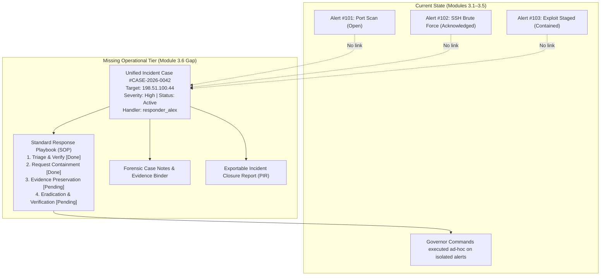
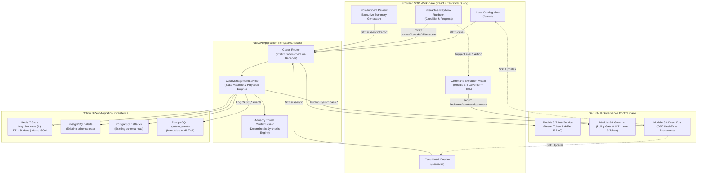
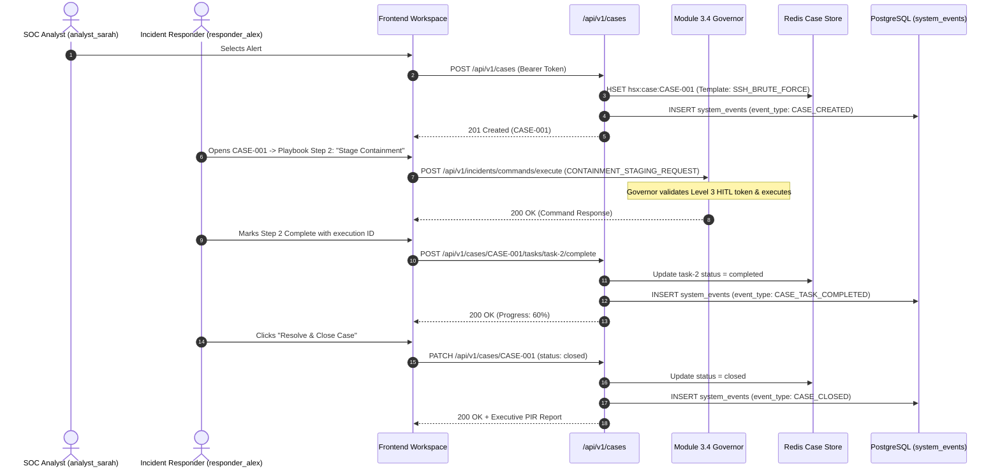

# HoneyShield-X — Module 3.6 Architecture & Research Reconciliation

**Document ID:** `HSX-ARCH-MOD-3.6-RECON`  
**Module Name:** Module 3.6 — SOC Incident Case Management & Interactive Response Playbooks (SOC Case Core)  
**Research Baseline Commit:** `bc249a79ddc4af6efb6ae8a2c6253c1cbb5d0079` (`feat: add operator authentication and audit compliance`)  
**Phase:** Phase 3 — SOC Operations, Observability & Web Workspace  
**Status:** **RESEARCH & ARCHITECTURE GATE (Pre-Implementation)**  
**Date:** 2026-10-08  
**Author:** HoneyShield-X Architecture & Systems Engineering  

---

## 1. Executive Summary

With the formal freezing of **Module 3.5 (Operator Authentication & Audit Compliance)** at commit `bc249a7`, HoneyShield-X has established an authenticated, deterministic control plane:
- Multi-vector detection, correlation, and composite risk scoring (Modules 2.1–2.10).
- SOC triage dashboards and alert visualization (Module 3.1).
- IP threat dossiers, GeoIP/ASN enrichment, and attack-chain graphs (Module 3.2).
- Detection rule consoles, linear AST simulation, and deterministic replay (Module 3.3).
- Real-time SSE streaming, singleton Governor policy, HITL Level 3 approval tokens, and circuit-breaker gating (Module 3.4).
- Opaque 256-bit CSPRNG bearer sessions, PBKDF2 password security, 4-tier RBAC (`viewer`, `analyst`, `incident_responder`, `security_administrator`), emergency break-glass, and compliance auditing (Module 3.5).

Despite these robust capabilities, an **operational workflow gap** exists at the center of the SOC: **Alerts and commands remain atomic and fragmented.** When an adversary launches a multi-stage intrusion (e.g. reconnaissance port scan, followed by SSH brute-force credential attacks, followed by lateral movement attempts), HoneyShield-X generates multiple isolated alerts. Operators have no native mechanism to:
1. Aggregate related alerts, attacks, and threat indicators into a unified **Incident Case**.
2. Assign an incident case to an authenticated handler with structured lifecycle tracking (`new`, `investigating`, `containment_in_progress`, `contained`, `resolved`, `closed`).
3. Follow an interactive, standard operating procedure (**SOP / Playbook Runbook**) based on industry standards (NIST SP 800-61 / SANS 6-step IR lifecycle).
4. Trigger Module 3.4 Governor commands directly from playbook task milestones with automatic Level 3 approval token binding.
5. Record immutable forensic notes, evidence logs, and export a structured **Post-Incident Review (PIR) / Executive Incident Brief**.
6. Provide explainable, advisory threat contextualization adhering strictly to the architectural tenet: **"Determinism for Detection; AI for Contextualization."**

This document establishes the architectural design, API contracts, data flows, persistence strategy, and security boundaries for **Module 3.6: SOC Incident Case Management & Interactive Response Playbooks**.

---

## 2. Current Frozen Baseline

The current baseline is frozen at commit:
```bash
commit bc249a79ddc4af6efb6ae8a2c6253c1cbb5d0079 (HEAD -> main)
Author: Liza K Varghese <lizakvarghesevarghese@gmail.com>
Date:   Thu Oct 8 17:20:58 2026 +0530

    feat: add operator authentication and audit compliance
```

### Frozen Predecessors
- **Phase 2 Pipeline (Modules 2.1–2.10):** Commit `da7e229` (`feat: add unified security processing engine`)
- **Module 3.1 SOC Workspace:** Commit `546add5` (`feat: add SOC dashboard core workspace`)
- **Module 3.2 Threat Intel & Graph:** Commit `998fc9f` (`feat: add threat intelligence and attack-chain explorer`)
- **Module 3.3 Rule Console & Replay:** Commit `fdcf0f3` (`feat: add detection rule console and deterministic replay`)
- **Module 3.4 Live Incident Command Core:** Commit `f4f9e9e` (`feat: add real-time incident operations core`)
- **Module 3.5 Operator Authentication & RBAC:** Commit `bc249a7` (`feat: add operator authentication and audit compliance`)

The working tree is completely clean and all 187 backend tests and 26 frontend tests pass unconditionally.

---

## 3. Existing Capability Inventory

| Module | Core Functionality | Frozen Public Interfaces & Contracts | Persistence Layer |
| :--- | :--- | :--- | :--- |
| **2.1–2.10** | Ingestion, normalization, multi-vector detection, correlation, threat intel, composite risk ($0\text{–}100$), alerts, webhooks. | `GET /attacks`, `POST /ingestion/events`, `GET /alerts`, `PATCH /alerts/{id}/status`, `POST /notifications/alerts/{id}`, `GET /correlation/ip/{ip}`, `POST /orchestrator/process/{id}` | PostgreSQL (`attacks`, `attack_events`, `alerts`, `threat_intelligence`, `system_events`) |
| **3.1** | SOC Dashboard: KPIs, 24h timeline, alert table, triage modal, event timeline drawer. | `GET /dashboard/summary`, `GET /dashboard/kpis`, `GET /dashboard/alerts/timeline`, `GET /dashboard/attacks/{id}/events` | Read-only aggregations over PostgreSQL |
| **3.2** | Threat Intel & Attack-Chain Explorer: IP dossier, GeoIP/ASN, multi-hop correlation graph. | `GET /investigation/dossier/{ip}`, `GET /investigation/graph/{ip}`, `POST /investigation/enrich` | Read-only graph projection over PostgreSQL |
| **3.3** | Detection Rule Console & Deterministic Replay: rule catalog, efficacy metrics, replay studio, simulation sandbox. | `GET /detection/rules`, `GET /detection/rules/{id}/efficacy`, `POST /replay/simulate`, `POST /replay/execute/{ip}` | In-memory rule catalog + read models |
| **3.4** | Real-Time Streaming & Live Incident Command: SSE event bus, Governor policy, HITL Level 3 approval tokens, circuit breaker, idempotency. | `GET /events/stream`, `POST /incidents/commands/execute`, `GET /incidents/commands/governor-status`, `POST /incidents/commands/circuit-breaker/reset` | Singleton Governor + in-memory SSE bus + `SystemEvent` audit |
| **3.5** | Operator Authentication & Deterministic RBAC: PBKDF2 login/logout, opaque 256-bit CSPRNG bearer sessions, Redis TTL, 4-tier RBAC, break-glass. | `POST /auth/login`, `POST /auth/logout`, `GET /auth/me`, `POST /auth/break-glass` | Redis session store (with memory fallback) + `SystemEvent` audit |

---

## 4. Gap Analysis

An operational security audit identifies three critical gaps in HoneyShield-X's SOC workflows:



1. **Alert Disconnection & Alert Fatigue:** Operators triage isolated alerts. There is no concept of grouping related alerts from the same attack chain or source IP into an overarching **Incident Case**.
2. **Lack of Guided Standard Operating Procedures (SOPs):** Operators execute incident commands manually without structured playbook checklists. Junior analysts risk skipping vital forensics, notifications, or eradication verification steps.
3. **No Case Audit History or Closure Documentation:** HoneyShield-X lacks a persistent record of who investigated a case, what forensic notes were taken, which playbook tasks were executed, and what the root-cause determination was upon resolution.

---

## 5. Candidate Modules

To resolve these operational limitations, three candidate architectures were developed:

---

### Candidate 1: Module 3.6 — SOC Incident Case Management & Interactive Response Playbooks (SOC Case Core)

- **Problem Solved:** Fragmented alert handling; lack of structured case aggregation; absence of standard operating procedures (SOPs); inability to document forensic findings and track incident resolution lifecycles.
- **Operator Value:** Allows SOC operators to group alerts and IOCs into formal Incident Cases, assign handlers, execute step-by-step response playbooks (e.g. Brute Force Playbook, Web Exploit Playbook, Data Exfiltration Playbook), trigger Module 3.4 Governor commands directly from playbook action items, record timestamped investigation notes, and export Post-Incident Review (PIR) summaries.
- **Current Gap Addressed:** Directly bridges the gap between atomic alert commands (Module 3.4) and organized security operations workflows.
- **Components Built Upon:** Module 3.4 Governor & command bus, Module 3.5 RBAC & authenticated identity, Module 3.1 Alert entity, Module 3.2 Threat Intel indicators, and `SystemEvent` audit persistence.
- **Architecture:** Zero-migration architecture (Option B) using Redis-backed case state storage with sliding cache, dynamic PostgreSQL entity joins, and `SystemEvent` audit ledger for permanent compliance persistence.
- **Backend APIs:**
  - `GET /api/v1/cases`: List incident cases with filtering by status, severity, handler.
  - `POST /api/v1/cases`: Create case manually or promote from an existing alert.
  - `GET /api/v1/cases/{case_id}`: Full case dossier including attached alerts, playbook tasks, and notes.
  - `PATCH /api/v1/cases/{case_id}/status`: Transition case status (`new` $\to$ `investigating` $\to$ `contained` $\to$ `resolved` $\to$ `closed`).
  - `POST /api/v1/cases/{case_id}/tasks/{task_id}/execute`: Mark task complete or trigger linked Governor command.
  - `POST /api/v1/cases/{case_id}/notes`: Append forensic investigation note.
  - `GET /api/v1/cases/{case_id}/report`: Generate structured Post-Incident Review (PIR) executive brief.
- **Frontend Experience:** New dedicated navigation view: **Incident Cases (`/cases`)**. Includes Case Kanban/Table, Case Detail Workspace, Interactive Playbook Runbook with progress meter, Investigation Journal, and One-Click Command Triggers.
- **Data Flow:** Operator/Auto-promotion $\to$ Case Creation $\to$ Playbook Template Binding $\to$ Operator Assignment $\to$ Playbook Task Execution $\to$ Governor Command Execution $\to$ Audit Persistence $\to$ Case Closure.
- **Persistence:** Option B (Zero-Migration): Redis hash/JSON store for case state and tasks + PostgreSQL `system_events` for immutable history.
- **Dependencies:** 0 new dependencies. Python standard library + existing Redis + SQLAlchemy.
- **Realtime:** SSE broadcasts on `system.case.created`, `system.case.updated`, `system.case.task_completed`.
- **Security Boundaries:** Strict RBAC enforcement: `case:view` (Viewer+), `case:triage` (Analyst+), `case:respond` (Responder+), `case:admin` (Security Admin). Level 3 actions continue through Module 3.4 Governor HITL approval token flow.
- **AI/LLM Involvement:** Advisory-only narrative generator using deterministic template fallback with optional LLM hook for executive brief drafting. Strict fail-closed heuristic. Zero autonomous authority.
- **Risks & Tradeoffs:** Managing case state in Redis requires robust serialization and PostgreSQL audit syncing; mitigated by existing atomic Redis client patterns.

---

### Candidate 2: Module 3.6 — AI-Assisted Threat Contextualization & Incident Copilot (Advisory-Only)

- **Problem Solved:** Analyst cognitive overload when parsing high-volume logs, raw threat intelligence scores, and multi-vector graph relationships.
- **Operator Value:** Generates human-readable incident narratives, explains risk score drivers, maps attack sequences to MITRE ATT&CK techniques, and suggests next triage steps in natural language.
- **Current Gap Addressed:** Lack of human-interpretable attack explanations.
- **Components Built Upon:** Module 2.8 Risk Assessment, Module 2.9 Multi-Vector Detection, Module 3.2 Threat Intel, Module 3.4 SSE bus.
- **Architecture:** Advisory copilot micro-service running outside the deterministic control plane. Strictly consumes read models; zero write access to Governor or alert states.
- **Backend APIs:**
  - `POST /api/v1/copilot/explain/alert/{id}`: Explain alert root-cause and risk drivers.
  - `POST /api/v1/copilot/explain/attack/{id}`: Generate attack chain narrative.
  - `POST /api/v1/copilot/query`: Natural language query translation over security telemetry.
- **Frontend Experience:** Slide-out "SOC Copilot" drawer available across all views with prominent `[ADVISORY ONLY]` visual badges.
- **Persistence:** In-memory / Redis cache for generated briefings. Zero migrations.
- **Dependencies:** Requires external LLM provider or local small model (e.g. Ollama/llama.cpp/OpenAI SDK), adding network and dependency complexity.
- **Security Boundaries:** Strictly isolated from control plane. Prompt injection defenses required. No tool-calling with mutation authority.
- **AI/LLM Involvement:** Core focus.
- **Risks & Tradeoffs:** Without a case management framework, generated insights are ephemeral and have no persistent operational container. Dependency on external LLM services introduces latency, token costs, and air-gapped deployment friction.

---

### Candidate 3: Module 3.6 — Honeypot Deception Grid & Canary Telemetry Observatory

- **Problem Solved:** Inability to monitor and inspect the underlying honeypot decoy nodes, emulated services (SSH Cowrie, HTTP honeypots, SMB decoys), and canary tokens.
- **Operator Value:** Gives operators complete situational awareness over their deception surface: node health, listener ports, decoy interaction frequency, and honey-token tripwires.
- **Current Gap Addressed:** Decoy infrastructure is currently treated as an opaque event emitter without operational management.
- **Components Built Upon:** Module 2.1 Ingestion, Module 2.4 Health Monitoring, Module 3.1 Health status ribbon.
- **Architecture:** Decoy node heartbeat registry with canary token trigger monitoring.
- **Backend APIs:**
  - `GET /api/v1/deception/decoys`: List registered decoy sensors and listener statuses.
  - `GET /api/v1/deception/canary-tokens`: Inspect deployed canary files/credentials.
  - `POST /api/v1/deception/decoys/heartbeat`: Ingest sensor node liveness.
- **Frontend Experience:** "Deception Grid" dashboard tab displaying decoy fleet map, listener statuses, and canary token alerts.
- **Persistence:** Option B: Redis heartbeat cache with PostgreSQL `system_events` logging.
- **Dependencies:** 0 new dependencies.
- **AI/LLM Involvement:** None.
- **Risks & Tradeoffs:** HoneyShield-X's primary user base is SOC analysts responding to attacks, not infrastructure engineers deploying decoys. Decoy management is traditionally a Phase 4/5 infrastructure concern.

---

## 6. Candidate Comparison Matrix

| Evaluation Dimension | Weight | Candidate 1: SOC Case Management & Playbooks | Candidate 2: AI Incident Contextualizer Copilot | Candidate 3: Honeypot Deception Grid |
| :--- | :---: | :---: | :---: | :---: |
| **SOC Operational Value** | 20% | **9.5/10** (Essential core workflow) | 7.5/10 (High advisory value) | 6.0/10 (Infrastructure focus) |
| **Immediate Architecture Need** | 20% | **10.0/10** (Unifies Alerts, Commands & RBAC) | 6.5/10 (Needs case container to bind to) | 5.5/10 (Better suited for Phase 4) |
| **Clean-Room & Determinism** | 15% | **10.0/10** (100% deterministic state machine) | 7.0/10 (Heuristic/LLM boundary risks) | 10.0/10 (100% deterministic telemetry) |
| **Zero-Migration Feasibility** | 15% | **9.5/10** (Option B verified via Redis+Audit) | 9.5/10 (Transient/cached read models) | 9.0/10 (Redis heartbeat store) |
| **Zero-Dependency Mandate** | 10% | **10.0/10** (Stdlib + existing Redis/SQLAlchemy) | 5.0/10 (Requires LLM client / tokenizer) | 10.0/10 (Stdlib only) |
| **Module 3.4/3.5 Integration** | 10% | **10.0/10** (Governor commands & RBAC roles) | 7.0/10 (Read-only observer) | 6.0/10 (Loose integration) |
| **Implementation Complexity** | 10% | **8.5/10** (Structured state machine) | 7.0/10 (Prompt engineering, parsing) | 8.5/10 (Heartbeat registry) |
| **Weighted Score** | **100%** | **9.55 / 10** | **7.15 / 10** | **7.05 / 10** |

---

## 7. Recommended Module 3.6

### Selected Architecture
**Candidate 1: Module 3.6 — SOC Incident Case Management & Interactive Response Playbooks (SOC Case Core)**

### Core Rationale
1. **Logical Progression:** Modules 3.4 (Commands) and 3.5 (Operator Identity) created the control plane. Module 3.6 creates the **operational container** where those controls are executed systematically.
2. **Alert Fatigue Elimination:** Consolidates related alerts by entity, attack ID, or threat actor into a single operational unit.
3. **Structured SANS/NIST Incident Response:** Enforces formal response stages (`Preparation`, `Identification`, `Containment`, `Eradication`, `Recovery`, `Lessons Learned`).
4. **Seamless Integration with Governor:** Playbook action items invoke Module 3.4 Governor commands directly (e.g. "Step 2: Stage Containment" $\to$ opens Governor execution modal with pre-filled Level 3 justification and approval flow).
5. **Incorporation of the Contextualization Principle:** Embeds an **Advisory Threat Contextualization Engine** within the Case Dossier that adheres strictly to:
   > **"Determinism for Detection; AI for Contextualization."**  
   The case lifecycle, task progression, and command execution are **100% deterministic**. The case summary generator uses deterministic rule-based template synthesis by default, with optional advisory LLM enhancement completely decoupled from the security control plane.

---

## 8. Detailed Architecture



---

## 9. API Contract Proposal

All endpoints require an active Bearer session token via `Authorization: Bearer <token>` and enforce deterministic RBAC.

### 1. List Incident Cases
`GET /api/v1/cases`
- **RBAC:** `case:view` (Roles: `viewer`, `analyst`, `incident_responder`, `security_administrator`)
- **Query Params:** `status`, `severity`, `handler_id`, `limit`, `offset`
- **Response `200 OK`:**
  ```json
  {
    "cases": [
      {
        "case_id": "CASE-2026-0001",
        "title": "Multi-Vector Credential Assault on SSH Sensor",
        "severity": "high",
        "status": "investigating",
        "assigned_to": "analyst_sarah",
        "source_ip": "198.51.100.44",
        "created_at": "2026-10-08T16:30:00Z",
        "updated_at": "2026-10-08T17:15:00Z",
        "alert_count": 3,
        "playbook_progress": 0.40
      }
    ],
    "total": 1
  }
  ```

### 2. Create Incident Case (Manual or Alert Promotion)
`POST /api/v1/cases`
- **RBAC:** `case:create` (Roles: `analyst`, `incident_responder`, `security_administrator`)
- **Request Body:**
  ```json
  {
    "title": "SSH Brute Force Intrusion",
    "severity": "high",
    "initial_alert_ids": [101, 102],
    "source_ip": "198.51.100.44",
    "playbook_template": "SSH_BRUTE_FORCE_SOP",
    "assigned_to": "responder_alex",
    "initial_note": "Initial triage confirmed credential stuffing from known malicious subnet."
  }
  ```
- **Response `201 Created`:** Full Case Object.

### 3. Get Case Dossier
`GET /api/v1/cases/{case_id}`
- **RBAC:** `case:view`
- **Response `200 OK`:** Full Case Object including:
  - Metadata, status, handler.
  - Linked alerts and attacks.
  - Playbook checklist with completed/pending tasks.
  - Forensic timeline notes.
  - Advisory Contextual Summary.

### 4. Update Case Status & Assignment
`PATCH /api/v1/cases/{case_id}`
- **RBAC:** `case:update` (Roles: `analyst`, `incident_responder`, `security_administrator`)
- **Request Body:**
  ```json
  {
    "status": "contained",
    "assigned_to": "responder_alex"
  }
  ```
- **Response `200 OK`:** Updated Case Object.

### 5. Execute / Progress Playbook Task
`POST /api/v1/cases/{case_id}/tasks/{task_id}/complete`
- **RBAC:** `case:respond` (Roles: `incident_responder`, `security_administrator`)
- **Request Body:**
  ```json
  {
    "notes": "Verified source IP added to drop list and no new connections established in 15 minutes.",
    "command_execution_id": "exec_84f9a" 
  }
  ```
- **Response `200 OK`:** Updated Playbook state with computed completion percentage.

### 6. Append Investigation Note
`POST /api/v1/cases/{case_id}/notes`
- **RBAC:** `case:update`
- **Request Body:**
  ```json
  {
    "message": "WHOIS lookup traces source IP to bulletproof hoster AS64500."
  }
  ```
- **Response `201 Created`:** Note record with authenticated operator attribution and UTC timestamp.

### 7. Generate Post-Incident Review (PIR) Report
`GET /api/v1/cases/{case_id}/report`
- **RBAC:** `case:view`
- **Response `200 OK`:**
  ```json
  {
    "case_id": "CASE-2026-0001",
    "executive_summary": "On 2026-10-08, HoneyShield-X detected and contained an SSH brute force assault originating from 198.51.100.44. Staged containment was executed under Governor policy in 4 minutes. Zero internal lateral movement was detected.",
    "timeline": [...],
    "playbook_adherence": "100% (5/5 tasks verified)",
    "remediation_actions": ["CONTAINMENT_STAGING_REQUEST executed", "NOTIFICATION_DISPATCH delivered to SOC webhook"],
    "root_cause_analysis": "External automated credential dictionary attack against SSH honeypot sensor.",
    "signoff_operator": "responder_alex",
    "generated_at": "2026-10-08T17:25:00Z"
  }
  ```

---

## 10. Frontend Architecture

### View Routing
Register `/cases` as a primary navigation workspace in [`Header.tsx`](file:///home/liza/HoneyShield-X/frontend/src/components/Header.tsx):
- `activeView`: `'dashboard' | 'investigation' | 'rules' | 'command' | 'cases'`

### Component Structure
```
frontend/src/
├── components/
│   ├── CaseManagementView.tsx        # Case table/cards, search, filter, status tabs
│   ├── CaseDetailDossier.tsx         # Full case view: header, timeline, playbook, notes
│   ├── CasePlaybookRunbook.tsx       # Interactive SOP checklist with Governor triggers
│   ├── CaseNotesJournal.tsx          # Forensic notes feed with operator attribution
│   ├── CasePromotionModal.tsx        # Promote single alert to an incident case
│   └── PostIncidentReportModal.tsx   # Executive summary preview and JSON/Markdown export
├── hooks/
│   └── useIncidentCases.ts           # TanStack Query mutations & queries for cases
└── types/
    └── index.ts                      # Case, PlaybookTask, CaseNote, PIRReport types
```

### Operator Workflow in UI
1. **Case Promotion:** In [`AlertTable.tsx`](file:///home/liza/HoneyShield-X/frontend/src/components/AlertTable.tsx), analyst clicks `"Promote to Case"`.
2. **Playbook Execution:** In `CaseDetailDossier`, responder sees the assigned SOP (e.g. SANS 6-step).
3. **Governor Command Action:** Task `"Execute Staged Containment"` displays a direct button `"Stage Containment"`. Clicking it opens [`CommandExecutionModal.tsx`](file:///home/liza/HoneyShield-X/frontend/src/components/CommandExecutionModal.tsx), automatically pre-populating the target and case ID.
4. **Real-Time Progress:** Playbook completion meter updates automatically via SSE events (`system.case.updated`).
5. **Closure & Reporting:** Closing the case generates an instant executive Post-Incident Review summary.

---

## 11. Data Flow



---

## 12. Persistence / Migration Analysis

### Option Comparison

| Strategy | Architecture | Pros | Cons | Recommendation |
| :--- | :--- | :--- | :--- | :--- |
| **Option A: PostgreSQL Tables via Alembic Migration** | Add `incident_cases`, `case_tasks`, `case_notes`, `case_alerts` tables. | Relational integrity, foreign keys to `alerts`. | Violates zero-migration mandate; risks database downtime; increases schema surface. | **REJECTED** |
| **Option B: Zero-Migration Architecture (Redis + SystemEvent Ledger)** | Store live active cases in Redis (`hsx:case:{id}`); persist all lifecycle mutations to PostgreSQL `system_events`. Dynamic query joins to `alerts` and `attacks`. | **Zero database migrations**; zero schema risk; lightning-fast read/write latency ($<5\text{ ms}$); audit compliance guaranteed; aligns with Modules 3.4 and 3.5. | Case queries rely on Redis; requires Redis for full case history. | **RECOMMENDED** |

### Selected Strategy: Option B (Zero-Migration Architecture)
- **Active State:** Stored in Redis under keys:
  - `hsx:case:{case_id}`: Hash/JSON storing title, severity, status, handler, playbook state, notes, alert references.
  - `hsx:cases:active`: Set of active case IDs.
  - `hsx:cases:by_operator:{operator_id}`: Set of cases assigned to operator.
  - **TTL:** 30 days (`2,592,000` seconds) on closed cases; indefinite on active cases.
- **Audit Persistence:** Every mutation writes an immutable JSON event to the existing `system_events` table:
  - `CASE_CREATED`, `CASE_UPDATED`, `CASE_TASK_COMPLETED`, `CASE_NOTE_ADDED`, `CASE_CLOSED`.
- **In-Memory Fallback:** If Redis is down, `CaseManagementService` falls back to an internal thread-safe dictionary, matching the Module 3.5 session store architecture.

---

## 13. Authentication & RBAC Integration

Module 3.6 integrates seamlessly with Module 3.5's deterministic 4-tier RBAC matrix:

| Permission String | Viewer | Analyst | Incident Responder | Security Administrator | Operations Granted |
| :--- | :---: | :---: | :---: | :---: | :--- |
| `case:view` | **ALLOW** | **ALLOW** | **ALLOW** | **ALLOW** | View cases, dossier, playbook progress, notes, reports. |
| `case:create` | DENY | **ALLOW** | **ALLOW** | **ALLOW** | Create cases, promote alerts to cases. |
| `case:update` | DENY | **ALLOW** | **ALLOW** | **ALLOW** | Reassign case, append investigation notes. |
| `case:respond` | DENY | DENY | **ALLOW** | **ALLOW** | Complete playbook tasks, transition status to `contained`/`resolved`. |
| `case:close` | DENY | DENY | **ALLOW** | **ALLOW** | Formally close case and sign off on PIR report. |
| `case:admin` | DENY | DENY | DENY | **ALLOW** | Delete draft case, override playbook template, audit export. |

---

## 14. Governor / HITL Integration

Module 3.6 strictly honors Module 3.4 Governor invariants:
1. **No Backdoor Execution:** Playbook tasks **never** execute defensive actions directly on the database or network. They invoke `execute_command_endpoint` via standard HTTP or service calls.
2. **HITL Level 3 Gate Preserved:** Containment actions triggered from a playbook task require an authenticated `incident_responder` and a valid, single-use approval token.
3. **Idempotency Preserved:** Playbook command executions pass a generated `X-Idempotency-Key` (UUID v4).
4. **Terminal Alert Immutability Preserved:** A case cannot mutate an already `resolved` or `suppressed` alert without receiving HTTP 409 Conflict.

---

## 15. Audit & Compliance Model

Every case action generates an immutable `SystemEvent` with full operator identity, client IP, and structured JSON message:

```json
{
  "event_type": "CASE_TASK_COMPLETED",
  "source": "case_management",
  "severity": "info",
  "message": {
    "case_id": "CASE-2026-0001",
    "task_id": "task_containment_verify",
    "task_title": "Verify Staged Containment",
    "operator_id": "responder_alex",
    "role": "incident_responder",
    "command_id": "exec_91e4a",
    "client_ip": "10.0.1.25",
    "timestamp": "2026-10-08T17:15:32Z"
  }
}
```

---

## 16. Failure / Recovery Model

1. **Redis Store Failure:** Automatically falls back to internal thread-safe in-memory case cache; logs warning; zero HTTP 500 crashes.
2. **Missing Alert References:** If an attached alert has been purged or deleted, the case dossier marks the alert as `[Archived/Unavailable]` without failing closed the entire case view.
3. **Concurrent Case Modifications:** Redis atomic transactions (`WATCH` / `MULTI` / `EXEC`) prevent conflicting updates when multiple operators edit the same case.
4. **Idempotent Task Completion:** Submitting completion for an already-completed task is idempotent (returns 200 with current state).

---

## 17. Performance & Scalability

- **API Latency:** Case listing and retrieval latency target: $< 30\text{ ms}$ (Redis in-memory retrieval).
- **Report Generation:** Deterministic PIR report synthesis: $< 15\text{ ms}$ (template-driven).
- **Memory Footprint:** Redis memory budget for 10,000 cases with 10 tasks and 5 notes each: $< 25\text{ MB}$.
- **Frontend Optimization:** TanStack Query cache key `['cases']` with 10-second stale time, refreshed instantly on SSE `system.case.*` events.

---

## 18. Testing Strategy

1. **Unit Tests (`test_module_3_6_cases.py`):**
   - Case creation, status transitions, playbook task lifecycle.
   - Dynamic template selection (SSH Brute Force, Web SQLi, Port Scan, Generic Incident).
   - In-memory fallback verification when Redis is disabled.
2. **RBAC & Security Tests (`test_module_3_6_rbac.py`):**
   - Viewer forbidden from creating cases (403).
   - Analyst forbidden from completing responder-level containment tasks (403).
   - Unauthenticated callers rejected (401).
3. **Governor Integration Tests (`test_module_3_6_governor_integration.py`):**
   - Playbook task containment execution requiring Level 3 approval token.
   - Idempotency deduplication during task execution.
4. **Adversarial Hostile Vectors:**
   - Case ID injection (path traversal, XSS in title/notes).
   - Concurrency race on task completion.
   - Forged operator header in case updates.
5. **Frontend Vitest Suite (`cases.test.tsx`):**
   - Kanban/Table render, status filtering, task checkbox toggles, report preview.

---

## 19. Clean-Room / Defensive Boundary Review

- **Zero CyberStrike Code:** Clean-room implementation. Zero offensive tools, zero port scanners, zero exploit generators.
- **Zero Shell Commands:** Zero `subprocess`, `os.system`, `eval()`, or `exec()`.
- **Purely Defensive SOAR:** Focuses exclusively on investigation workflow, evidence logging, and guided mitigation.
- **AI Boundary Integrity:** Any contextualization or summary generation is strictly advisory, read-only, non-autonomous, and backed by a deterministic offline heuristic fallback.

---

## 20. Implementation Sequence

The implementation of Module 3.6 will proceed through 5 strictly gated stages:

1. **Stage 1: Case Domain & Playbook Engine:**
   - Define Pydantic schemas in `backend/app/schemas.py`.
   - Implement `CaseManagementService` and SOP templates in `backend/app/cases/service.py`.
2. **Stage 2: API Router & RBAC Permissions:**
   - Implement `backend/app/routers/cases.py` with `require_permission` dependencies.
   - Register router in `backend/app/main.py`.
3. **Stage 3: Frontend Case Workspace:**
   - Implement `CaseManagementView.tsx`, `CaseDetailDossier.tsx`, `CasePlaybookRunbook.tsx`, and `useIncidentCases.ts`.
   - Add navigation tab in `Header.tsx` and route in `App.tsx`.
4. **Stage 4: Automated Verification & Hostile Testing:**
   - Write comprehensive pytest regression suite (`backend/tests/test_module_3_6_*.py`).
   - Write frontend vitest suite (`frontend/src/components/__tests__/cases.test.tsx`).
5. **Stage 5: Production Build & Audit Gate:**
   - Verify 0 migrations, 0 dependencies, full test suite pass, and clean production build.

---

## 21. Risks & Tradeoffs

| Risk | Impact | Likelihood | Mitigation Strategy |
| :--- | :---: | :---: | :--- |
| **Redis Volatility:** Active cases lost if Redis restarts without persistence. | High | Low | Redis RDB/AOF persistence enabled; immutable audit log preserved in PostgreSQL `system_events`. |
| **Playbook Rigidity:** Pre-defined SOPs may not fit novel multi-vector attack scenarios. | Medium | Medium | Include a "Generic SOC Incident SOP" template with customizable ad-hoc tasks. |
| **Governor Redundancy:** Potential confusion between executing commands in Module 3.4 vs Module 3.6. | Medium | Low | Unified UX: Playbook tasks embed and trigger the exact same `CommandExecutionModal` from Module 3.4. |
| **Contextualizer Drift:** AI summary generating inaccurate incident details. | Medium | Low | Strict deterministic template engine as primary baseline; all AI output prominently watermarked as advisory. |

---

## 22. Acceptance Criteria

To be approved for freeze, Module 3.6 must satisfy:
1. **Zero Database Migrations:** `alembic/versions/` remains untouched.
2. **Zero Dependencies Added:** No new packages in `pyproject.toml` or `package.json`.
3. **Full RBAC Enforcement:** Every case endpoint requires valid session and enforces 4-tier RBAC (401/403).
4. **Module 3.4 Governor Continuity:** Level 3 approval tokens remain mandatory for containment tasks.
5. **Complete Test Suite Pass:** 187 existing backend tests pass + new Module 3.6 tests pass.
6. **Frontend Test Suite Pass:** 26 existing frontend tests pass + new cases tests pass.
7. **Clean Production Build:** `vite build` completes with 0 errors.

---

## 23. Final Architecture Gate Verdict

```text
APPROVED WITH CONDITIONS — READY FOR IMPLEMENTATION
```

### Mandatory Conditions for Implementation
1. **Option B Zero-Migration Compliance:** Implementation MUST NOT create Alembic migrations or modify SQLAlchemy models. Case state must use Redis with in-memory fallback, and audit logging must use `SystemEvent`.
2. **Standard Library & Existing Dependencies Only:** Implementation MUST NOT add third-party dependencies or external LLM packages.
3. **Strict Governor Binding:** Any defensive command triggered from a case playbook MUST flow through `default_governor` and require valid HITL approval tokens for Level 3 actions.
4. **Deterministic Primary Contextualizer:** Case summaries and PIR reports MUST be generated deterministically via structured template heuristics. Any LLM integration must remain strictly optional, advisory, non-autonomous, and fail-closed.
5. **Clean-Room Enforcement:** Zero offensive tools, zero shell commands, zero network modification code.

---

*HoneyShield-X Architecture Gate 3.6 Concluded. Ready to proceed to Module 3.6 Implementation upon user directive.*
