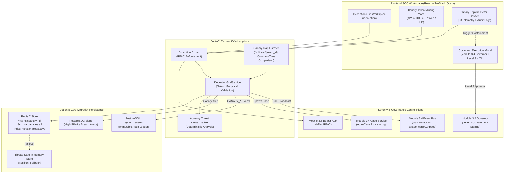

# HoneyShield-X — Module 3.7 Architecture & Research Reconciliation Report

**Document ID:** `HSX-ARCH-MOD-3.7-RECON`
**Target Module:** Module 3.7 — Active Deception Grid & Canary Honeytoken Orchestrator (Deception Core)
**Preceding Frozen Baseline:** `2307fbf4b7b3d42fd616b753ab25a11e1646df02` (`feat: add soc incident case management and response playbooks`)
**Preceding Module:** Module 3.6 — SOC Incident Case Management & Interactive Response Playbooks
**Status:** ARCHITECTURE & RESEARCH GATE COMPLETE
**Gate Date:** 2026-10-08
**Clean-Room Classification:** 100% Defensive Deception & Sensor Telemetry; Zero Offensive Primitives
**Zero-Migration Policy:** 100% Option B Compliant (Redis 7 + PostgreSQL `system_events` audit ledger)
**Zero-Dependency Policy:** 100% Compliant (Python standard library `secrets`, `hmac`, `hashlib`, `uuid`)

---

## 1. Executive Summary

Following the formal verification and local freeze of **Module 3.6 (SOC Incident Case Management & Interactive Response Playbooks)** at commit `2307fbf4b7b3d42fd616b753ab25a11e1646df02`, this architecture and research gate evaluates the optimal next capability for HoneyShield-X in **Phase 3**.

HoneyShield-X is architecturally positioned as an **Autonomous Honeypot & Intrusion Defense Platform**. Across Phase 2 and Modules 3.1–3.6, HoneyShield-X established a robust defensive foundation:
- Telemetry ingestion from standard network decoy ports (SSH, HTTP, FTP, Port Scans).
- Correlation, risk scoring, and attack-chain tracking.
- Detection rule creation and deterministic IP replay simulation.
- Real-time incident command operations governed by a strict circuit breaker and Level-3 Human-In-The-Loop (HITL) approval tokens.
- Cryptographically hardened operator authentication, sessions, and 4-tier RBAC.
- Formal SOC Incident Case Management with NIST SP 800-61 / SANS response playbooks and post-incident reporting.

### The Remaining Strategic SOC Gap
Currently, HoneyShield-X honeypots rely exclusively on **static decoy listeners**. Once an adversary establishes initial access or moves laterally across an organization, perimeter sensors become blind unless the adversary hits a known decoy socket. In modern cyber defense, the most lethal, zero-false-positive method to detect adversary lateral movement, credential dumping, and data exfiltration is **Active Deception via Honeytokens & Canary Tripwires** (e.g. Canary AWS credentials, decoy database connection strings, fake service API tokens, decoy configuration files, and web beacons).

When an adversary discovers and attempts to use a honeytoken, it provides an **unambiguous, 100% true-positive indicator of compromise (IOC)**. Legitimate users never touch decoy canary assets.

This report evaluates four architectural candidates and recommends:
**Module 3.7: Active Deception Grid & Canary Honeytoken Orchestrator (Deception Core)**.

---

## 2. Current Capability Inventory & Baseline State

### A. Phase 2 Frozen Core Pipeline (Modules 2.1 – 2.5)
- **Ingestion & Database:** PostgreSQL models (`Attack`, `AttackEvent`, `Alert`, `ThreatIntelligence`, `SystemEvent`).
- **Notification Engine:** Deduplicated alert dispatch to external webhooks with atomic row leases.
- **Correlation Engine:** Temporal clustering ($T=60\text{s}$ window) and multi-vector attack grouping.
- **Risk Engine:** Deterministic multi-factor scoring ($R \in [0, 100]$) mapping attacks into low/medium/high/critical bands.
- **Unified Pipeline:** Orchestrated end-to-end event-to-alert processing.

### B. Phase 3 Frozen Modules (Modules 3.1 – 3.6)
- **Module 3.1 (SOC Dashboard):** Live KPI ribbons, active attack distribution, real-time alert feeds.
- **Module 3.2 (Threat Intelligence & Attack-Chain Explorer):** Exact indicator lookups, MITRE ATT&CK technique mapping, timeline investigation.
- **Module 3.3 (Detection Rule Console & Deterministic Replay):** Rule catalog, ReDoS-safe regex evaluation, deterministic IP replay studio, sandbox efficacy calculations.
- **Module 3.4 (Real-Time Incident Operations Core & Governor):** Blast-tier authorization, rate limiters, entity cooldowns, Redis Pub/Sub SSE event streaming, circuit breaker, and mandatory Level-3 HITL two-phase approval tokens for state-changing commands (`CONTAINMENT_STAGING_REQUEST`, `FIREWALL_RULE_DEPLOY`).
- **Module 3.5 (Operator Authentication, RBAC & Audit Compliance):** PBKDF2-HMAC-SHA256 password security, 256-bit CSPRNG bearer sessions with SHA-256 token hashing, 4-tier RBAC (`viewer`, `analyst`, `incident_responder`, `security_administrator`), account lockouts, emergency break-glass procedure, and complete elimination of unauthenticated headers.
- **Module 3.6 (SOC Incident Case Management & Response Playbooks):** Deterministic case state machine (`new` $\to$ `investigating` $\to$ `containment_in_progress` $\to$ `contained` $\to$ `resolved` $\to$ `closed`), 4 standardized SANS/NIST playbooks, command binding to Governor execution IDs, tamper-resistant closed case protection, deterministic PIR reporting, and Option B Redis persistence with PostgreSQL `system_events` immutable ledger.

---

## 3. Remaining Architectural Gaps in Phase 3

| Architectural Area | Current State in HoneyShield-X | Operational / Strategic Gap |
| :--- | :--- | :--- |
| **Decoy Diversity** | Static network ports only (SSH, HTTP, FTP). | No dynamic honeytokens, canary credentials, or decoy files placed in protected systems. |
| **Lateral Movement Detection** | Relies on direct network scans against sensor IP. | Blind to adversary lateral movement, credential dumping (Mimikatz, memory scraping), or cloud credential theft. |
| **False-Positive Elimination** | Rule-based heuristics require tuning and thresholding. | Zero-false-positive tripwires (canaries) are absent; tripwires guarantee 100% fidelity without tuning. |
| **Automated Containment Arming** | Playbooks manually stage containment requests. | Honeypot tripwires cannot automatically prime the Governor with pre-correlated threat actor signatures. |
| **Deception Asset Tracking** | No registry of deployed decoy assets or canary tokens. | Operators cannot generate, track, rotate, or revoke honeytokens deployed across enterprise environments. |

---

## 4. Candidate Architecture Directions for Module 3.7

We evaluate four candidate modules for the next phase of HoneyShield-X:

### Candidate A: Active Deception Grid & Canary Honeytoken Orchestrator (Deception Core)
- **Core Concept:** Introduces a centralized Deception Grid and Canary Honeytoken lifecycle manager into HoneyShield-X. Operators can generate, deploy, monitor, and revoke honeytokens across 5 distinct canary asset classes:
  1. `AWS_API_KEY`: Fake IAM access keys placed in `.aws/credentials` or git repos.
  2. `DATABASE_CREDENTIAL`: Decoy SQL/NoSQL connection strings placed in configuration files or memory decoys.
  3. `SERVICE_API_TOKEN`: Decoy internal API tokens (Bearer tokens) placed in decoy environment variables.
  4. `WEB_TRIPWIRE_ENDPOINT`: Unique decoy HTTP URLs and tracking pixels for directory traversal or credential stuffing traps.
  5. `CANARY_FILE_BEACON`: Decoy sensitive documents (`passwords.xlsx`, `network_diagram.pdf`) with embedded loopback tracking beacons.
- **Detection Mechanism:** HoneyShield-X hosts deterministic, constant-time validation listeners (`/api/v1/deception/validate/...`). Any adversary attempt to use or query a canary credential triggers an instantaneous, high-fidelity alert (`ALERT_CANARY_TRIPPED`), automatically promotes the tripwire into a Critical Incident Case (Module 3.6), links threat telemetry (Module 3.2), and stages Level-3 containment against the adversary entity via Module 3.4 Governor.
- **Persistence:** Option B (Redis `hsx:canary:{id}` + PostgreSQL `system_events` audit ledger). Zero database migrations.
- **Dependencies:** Standard library (`secrets`, `hmac`, `hashlib`, `uuid`). Zero new dependencies.

### Candidate B: SOC Operations Intelligence, SLA Governance & Shift Handover Dossier (SOC Intelligence Core)
- **Core Concept:** Introduces quantitative SOC management analytics, tracking Mean Time to Detect (MTTD), Mean Time to Acknowledge (MTTA), Mean Time to Contain (MTTC), and Mean Time to Resolve (MTTR) across incident cases, along with SLA policy enforcement and formal Shift Handover reporting.
- **Features:**
  - Configurable SLA policies per severity tier (e.g. Critical containment within 15 min; High within 60 min).
  - SLA breach warnings and automated escalation markers.
  - Formal Shift Handover Dossier generator: outgoing operator signs a cryptographically bound briefing summarizing active cases, pending Governor containment approvals, sensor health, and open alerts for incoming shift operators.
  - Analyst workload distribution and case throughput metrics.
- **Persistence:** Option B (Dynamic calculation over existing `cases` and `system_events` + Redis shift cache). Zero database migrations.
- **Dependencies:** Zero new dependencies.

### Candidate C: Threat Intelligence Automation, IOC Lifecycle Decaying & STIX/TAXII Feed Exporter (Threat Sharing Hub)
- **Core Concept:** Extends Module 3.2 Threat Intelligence from static query lookups into an active automated IOC lifecycle engine and perimeter feed exporter.
- **Features:**
  - Automated IOC decaying algorithms (confidence scores decay over time unless renewed by new attacks).
  - Outbound defense feed exporter: generates RFC 5737 compliant IP drop lists, Snort/Suricata network rules, and STIX 2.1 JSON bundles.
  - Enables enterprise firewalls (pfSense, FortiGate, Palo Alto) to consume dynamic blocking feeds generated by HoneyShield-X honeypots.
- **Persistence:** Option B (Redis IOC cache + existing `threat_intelligence` table). Zero database migrations.
- **Dependencies:** Zero new dependencies if STIX 2.1 is serialized using standard JSON schemas.

### Candidate D: Enterprise SIEM/SOAR Bi-Directional Webhook Gateway & Security Automation Hub
- **Core Concept:** Establishes a hardened, bi-directional integration hub connecting HoneyShield-X to external enterprise SIEM platforms (Splunk HEC, Elastic SIEM, Microsoft Sentinel) and SOAR orchestration engines (Cortex XSOAR, Tines, Shuffle).
- **Features:**
  - HMAC-SHA256 signed outbound webhooks with exponential backoff and dead-letter queues.
  - Inbound webhook receiver allowing external SOAR tools to ingest alerts or request playbook status.
- **Persistence:** Option B (Redis webhook subscription catalog + PostgreSQL audit ledger). Zero database migrations.
- **Dependencies:** Zero new dependencies.

---

## 5. Comparative Evaluation Matrix

| Evaluation Dimension | Candidate A: Deception Grid & Honeytokens (Recommended) | Candidate B: SOC Operations Intelligence & SLA | Candidate C: Threat Intel Automation & STIX/TAXII | Candidate D: SIEM/SOAR Integration Gateway |
| :--- | :---: | :---: | :---: | :---: |
| **Defensive Security Value** | **EXTREME** (Zero false-positive lateral movement & credential theft tripwires) | **MEDIUM** (Operational governance & reporting) | **HIGH** (Perimeter defense feed sharing) | **HIGH** (Third-party SOC interoperability) |
| **Honeypot Core Identity** | **DIRECT CORE** (Fulfills the core mission of HoneyShield-X as an active deception platform) | **ANCILLARY** (Generic SOC management capability) | **SUPPORTING** (Enrichment and export) | **SUPPORTING** (External routing) |
| **Zero-Migration Compliance** | **100% Option B** (Redis + `system_events` audit ledger) | **100% Option B** (Redis + `system_events`) | **100% Option B** (Redis + `threat_intelligence`) | **100% Option B** (Redis + `system_events`) |
| **Zero-Dependency Compliance** | **100% Compliant** (Python `secrets`, `hmac`, `hashlib`) | **100% Compliant** (Standard Python math/datetime) | **100% Compliant** (Standard JSON STIX mapping) | **100% Compliant** (Standard `urllib`/`psycopg`) |
| **Governor Integration** | **DEEP** (Canary hits directly stage Level-3 containment via Governor) | **INDIRECT** (Tracks Governor response latency) | **INDIRECT** (Exports Governor target IPs to blocklists) | **MODERATE** (SOAR webhook trigger for Governor) |
| **Module 3.6 Case Integration** | **DEEP** (Automatically provisions Incident Cases with linked canaries) | **DIRECT** (Measures case lifecycle stages) | **MODERATE** (Attaches threat feeds to cases) | **MODERATE** (Exports case notes to external SIEM) |
| **Deterministic Control Plane** | **100% Preserved** (Constant-time token validation) | **100% Preserved** (Deterministic SLA calculations) | **100% Preserved** (Deterministic decay math) | **100% Preserved** (HMAC-SHA256 signatures) |
| **Clean-Room Assurance** | **100% Verified** (Purely passive decoy credential generation) | **100% Verified** (Internal metrics analysis) | **100% Verified** (Passive feed generation) | **100% Verified** (Standard webhooks) |
| **Engineering Complexity** | **MODERATE** (Sensors, validation routes, token generators) | **LOW-MODERATE** (Analytical queries, state diffs) | **MODERATE** (Feed formats, decay tasks) | **MODERATE** (Queueing, retries, HMAC) |

---

## 6. Recommended Selection: Candidate A (Deception Core)

### Strategic & Architectural Rationale
1. **Fulfills the Honeypot Identity:** HoneyShield-X is explicitly an "Autonomous Honeypot & Intrusion Defense Platform". While Modules 3.1–3.6 constructed the SOC management and operational command tier, HoneyShield-X's deception surface remains restricted to legacy network listeners. Candidate A elevates HoneyShield-X into an **enterprise active deception grid**.
2. **Zero False-Positive Tripwires:** In modern SOC operations, alert fatigue is the primary failure mode. Rule heuristics and anomaly detectors produce false alarms. In contrast, **Canary Honeytokens have a 0% false positive rate**: no legitimate employee, pipeline, or service ever has a reason to use a canary AWS key or query a decoy database. A canary tripwire is an indisputable breach signal.
3. **Seamless Synthesis with Prior Modules:**
   - **Module 3.4 Governor:** A canary tripwire automatically stages a high-priority `CONTAINMENT_STAGING_REQUEST` under Level-3 HITL approval.
   - **Module 3.5 RBAC:** Only operators with `deception:create` and `deception:admin` can mint or revoke canaries.
   - **Module 3.6 Cases:** A canary breach immediately provisions an accountable `IncidentCase` with pre-filled IOCs, an assigned SOP (`GENERIC_INCIDENT_SOP`), and high priority.
4. **Clean-Room & Zero-Migration Guarantee:** Canary tokens are generated using standard library CSPRNG (`secrets.token_hex`, `secrets.token_urlsafe`), stored in Redis with atomic pipelines, and immutably audited to PostgreSQL `system_events`. Zero database migrations and zero third-party dependencies are required.

---

## 7. Proposed Architecture for Module 3.7



---

## 8. Proposed Backend API Contract

### Summary of New Endpoints (`/api/v1/deception`)

| Method | Endpoint | Required Permission | Allowed Roles | Description |
| :---: | :--- | :--- | :--- | :--- |
| **GET** | `/api/v1/deception/canaries` | `deception:view` | `viewer`, `analyst`, `incident_responder`, `security_administrator` | List deployed canary tokens with filters (type, status, environment). |
| **POST** | `/api/v1/deception/canaries` | `deception:create` | `analyst`, `incident_responder`, `security_administrator` | Mint a new canary honeytoken with metadata, placement tags, and decoy payload. |
| **GET** | `/api/v1/deception/canaries/{id}` | `deception:view` | `viewer`, `analyst`, `incident_responder`, `security_administrator` | Retrieve detailed canary dossier including interaction history. |
| **PATCH** | `/api/v1/deception/canaries/{id}` | `deception:update` | `analyst`, `incident_responder`, `security_administrator` | Update canary metadata, label, or deployment status (`active`, `revoked`). |
| **DELETE** | `/api/v1/deception/canaries/{id}` | `deception:admin` | `security_administrator` | Formally revoke and decommission a canary honeytoken. |
| **GET** | `/api/v1/deception/hits` | `deception:view` | `viewer`, `analyst`, `incident_responder`, `security_administrator` | List tripwire interaction events with adversary IP, user-agent, and payload. |
| **GET / POST** | `/api/v1/deception/validate/{token_id}` | *Unauthenticated / Trap Endpoint* | Public Trap / Adversary Encounter | Trap endpoint triggered by adversary. Emits high-fidelity alert, creates case, and logs audit. |

### RBAC Permission Extensions (Module 3.7)
Deterministic permissions appended to `app/auth/registry.py`:
- `deception:view`: Viewer, Analyst, Responder, Administrator.
- `deception:create`: Analyst, Responder, Administrator.
- `deception:update`: Analyst, Responder, Administrator.
- `deception:admin`: Security Administrator only.

---

## 9. Proposed Data Model & State Persistence (Option B)

### Zero-Migration Architecture
- **Primary Store:** Redis 7 via atomic multi/exec pipelines:
  - `hsx:canary:{canary_id}`: JSON record representing the Canary entity.
  - `hsx:canary:lookup:{token_hash}`: Hash index mapping token hashes to `canary_id` for $O(1)$ constant-time lookup.
  - `hsx:canaries:all`: Set of all registered canary IDs.
  - `hsx:canaries:active`: Set of currently active tripwires.
  - `hsx:canary:hits:{canary_id}`: List of timestamped hit records.
- **Resilient Fallback:** Thread-safe in-memory dictionaries `_memory_canaries` and `_memory_hits` protected by `threading.Lock`. Seamlessly activates if Redis is offline.
- **Compliance Audit Ledger:** Immutable audit events recorded to PostgreSQL `system_events`:
  - `CANARY_MINTED`: Recorded when an operator creates a honeytoken.
  - `CANARY_TRIPPED`: Recorded when an adversary interacts with a honeytoken.
  - `CANARY_UPDATED`: Recorded when canary metadata changes.
  - `CANARY_REVOKED`: Recorded when a honeytoken is decommissioned.
- **Breach Alert Injection:** A canary tripwire hit writes an atomic record to the PostgreSQL `alerts` table (`alert_type="CANARY_TRIPWIRE_TRIGGERED"`, `severity="critical"`, `status="open"`).

---

## 10. Frontend / Operator Workflow

1. **Header Navigation:** New tab `'deception'` added to `Header.tsx` ("Deception Grid").
2. **Deception Grid Workspace (`DeceptionGridView.tsx`):**
   - KPI Ribbon: Total Canaries, Active Tripwires, Tripped Count, Mean Time to Trip.
   - Filterable Table: Canary Name, Type Badge (AWS, DB, API, Web, File), Environment Tag, Hits Counter, Status, Creation Date.
   - "Mint Canary Honeytoken" CTA button.
3. **Canary Minting Modal (`CanaryMintModal.tsx`):**
   - Select asset class: AWS IAM Key, Database Connection String, API Bearer Token, Web Tracking URL, File Beacon.
   - Provide placement description (e.g. `Server /var/www/.env file`, `Git repo commit`, `SQL decoy table`).
   - Generates authentic-looking decoy credentials ready for copy-pasting into target environments.
4. **Tripwire Hit Alert Banner & Dossier (`CanaryDetailDossier.tsx`):**
   - Detailed timeline of all adversary interactions with the honeytoken (IP, timestamps, request headers, payload attempted).
   - "Promote Tripwire to Case" button (pre-fills Module 3.6 Case Promotion Modal with adversary IP and alert ID).
   - "Stage Immediate Ingress Containment" button (launches Module 3.4 Governor Command Execution Modal with pre-flight Level-3 HITL token).

---

## 11. Clean-Room & Offensive Security Boundary Analysis

| Principle / Rule | Compliance Analysis | Status |
| :--- | :--- | :---: |
| **No Offensive Tools** | No port scanners, vulnerability scanners, or exploit frameworks. Honeytokens are passive decoys only. | **PASS** |
| **No Payload Generation** | Does not generate offensive shellcode, malware, or exploits. Decoy files are benign tracking templates or inert strings. | **PASS** |
| **No Credential Scraping** | Honeytokens are generated de-novo using CSPRNG; HoneyShield-X never scrapes real user credentials or memory. | **PASS** |
| **No Active Network Probing** | HoneyShield-X never sends unsolicited packets to external networks or performs offensive reconnaissance. | **PASS** |
| **No Autonomous Authority** | Canaries alert and correlate; containment actions require explicit operator HITL tokens via Module 3.4 Governor. | **PASS** |
| **Clean-Room Codebase** | Zero reuse of CyberStrike, CyberStrikeAI, or third-party offensive tools. Pure standard-library defensive software. | **PASS** |

---

## 12. Reconciliation with Existing Core Systems

- **Module 3.4 Governor Reconciliation:** When a canary is tripped, the operator is prompted with an immediate containment staging shortcut. The Governor's circuit breaker, allowlist, entity cooldowns, rate limits, and Level-3 HITL approval tokens (`CONTAINMENT_STAGING_REQUEST`) remain 100% authoritative and inviolable.
- **Module 3.5 Authentication & RBAC Reconciliation:** All deception management routes require authenticated Bearer tokens and fine-grained `deception:*` permissions. Viewers cannot mint or modify canaries.
- **Module 3.6 Case Core Reconciliation:** Tripped canaries link directly to the Case Management service, allowing 1-click creation of formal incident cases with pre-populated IOCs and bound SOP playbooks.
- **Module 3.4 SSE Event Bus Reconciliation:** Tripwire events publish `system.canary.tripped` events with sanitized, non-secret payloads to the live SSE bus for instantaneous SOC dashboard notification.

---

## 13. Threat Model & Abuse Analysis

1. **Adversary Token Enumeration / Brute-Force:**
   - *Threat:* Adversary attempts to guess valid canary token strings.
   - *Defense:* Tokens utilize 256-bit CSPRNG entropy (`secrets.token_urlsafe(32)` $\ge 10^{77}$ combinations), making offline or online enumeration mathematically impossible.
2. **Timing Attacks on Validation Listener:**
   - *Threat:* Attacker probes validation endpoints using timing variations to guess valid token prefixes.
   - *Defense:* Token verification uses `hmac.compare_digest` for constant-time cryptographic equality comparisons.
3. **Denial of Service on Trap Endpoint:**
   - *Threat:* Adversary floods the trap listener `/api/v1/deception/validate/{token_id}` with millions of requests.
   - *Defense:* Per-IP rate limiting and in-memory hit deduplication prevent flood-induced resource exhaustion.
4. **Forged Tripwire Alerts:**
   - *Threat:* Attacker tries to inject fake canary hits via spoofed headers.
   - *Defense:* Tripwire events verify token existence in Redis, log raw client IP from network connection, and attribute records to `source="deception_grid"`.

---

## 14. Testing & Hostile Audit Strategy

The implementation of Module 3.7 will require:
1. **Unit & Integration Suite (`test_module_3_7_deception.py`):**
   - Canary token generation across all 5 classes.
   - Validation trap hit detection and alert generation.
   - Constant-time verification timing analysis.
   - Deception token revocation and decommission semantics.
2. **RBAC Boundary Suite (`test_module_3_7_rbac.py`):**
   - Viewer restricted to read-only (`deception:view`).
   - Analyst permitted `deception:create` and `deception:update`.
   - Administrator exclusive access to `deception:admin` (revocation).
   - Missing/malformed token rejection (HTTP 401).
3. **Governor & Case Handoff Suite (`test_module_3_7_integration.py`):**
   - Canary tripwire $\to$ Alert generation $\to$ Case creation $\to$ Governor Level-3 containment handoff.
4. **Hostile Adversarial & Concurrency Audit:**
   - 30+ adversarial probing tests (spoofed tokens, brute-force bursts, path traversals).
   - Multi-threaded concurrent hit burst testing (10+ simultaneous requests to same canary).

---

## 15. Implementation Sequence & Plan

1. **Phase 1: Backend Schemas & Storage Layer:**
   - Define Pydantic schemas in `app/schemas.py` (`CanaryToken`, `CanaryCreateRequest`, `CanaryHitEvent`).
   - Implement `DeceptionStore` in `app/deception/storage.py` with Redis pipelines and in-memory fallback.
2. **Phase 2: Core Deception Service & Trap Engine:**
   - Implement `DeceptionGridService` in `app/deception/service.py` with cryptographic token generators.
   - Implement trap listener and alert/case cross-linkers.
3. **Phase 3: API Router & RBAC Permissions:**
   - Update `CASE_ROLE_PERMISSIONS` in `app/auth/registry.py` with `DECEPTION_ROLE_PERMISSIONS`.
   - Implement FastAPI router in `app/routers/deception.py` and mount in `app/main.py`.
4. **Phase 4: Frontend SOC Deception Workspace:**
   - Add types, API client calls, and TanStack Query hooks.
   - Implement `DeceptionGridView`, `CanaryMintModal`, and `CanaryDetailDossier`.
   - Update `Header.tsx` and `App.tsx` routing.
5. **Phase 5: Full Regression & Hostile Pre-Freeze Security Audit.**

---

## 16. Architectural Verdict

```
=====================================================================
               ARCHITECTURE GATE VERDICT:
     APPROVED WITH CONDITIONS — READY FOR IMPLEMENTATION
=====================================================================
```

### Mandatory Implementation Conditions:
1. **ZERO DATABASE MIGRATIONS:** Implement 100% under Option B using Redis 7 for active canary state, coupled with a thread-safe in-memory fallback, and PostgreSQL `system_events` for immutable audit logging. Do not alter `backend/app/models.py`.
2. **ZERO NEW DEPENDENCIES:** Use existing Python standard library cryptography (`secrets`, `hmac`, `hashlib`, `uuid`) and existing Redis/SQLAlchemy infrastructure.
3. **ZERO OFFENSIVE CAPABILITY:** All canary honeytokens must be purely passive decoys and tripwires. No offensive reconnaissance, scanning, credential scraping, or external network mutations.
4. **GOVERNOR CONTINUITY:** Module 3.4 Governor remains the sole authority for state-changing operational commands. Canary tripwires must route containment actions through Level-3 HITL approval tokens.
5. **DETERMINISTIC CONTROL PLANE:** Token validation must execute deterministically using constant-time comparisons (`hmac.compare_digest`). Any advisory AI contextualization must remain read-only and fail-closed.
6. **MANDATORY AUTHENTICATION & RBAC:** All `/api/v1/deception` management endpoints must enforce Module 3.5 Bearer authentication and 4-tier RBAC (`deception:view`, `deception:create`, `deception:update`, `deception:admin`).
7. **COMPLIANCE AUDITING:** Every canary lifecycle event (`CANARY_MINTED`, `CANARY_TRIPPED`, `CANARY_UPDATED`, `CANARY_REVOKED`) must write an immutable audit event to PostgreSQL `system_events`.
